# Projects and dependencies analysis

This document provides a comprehensive overview of the projects and their dependencies in the context of upgrading to .NETCoreApp,Version=v10.0.

## Table of Contents

- [Executive Summary](#executive-Summary)
  - [Highlevel Metrics](#highlevel-metrics)
  - [Projects Compatibility](#projects-compatibility)
  - [Package Compatibility](#package-compatibility)
  - [API Compatibility](#api-compatibility)
  - [Binding Redirect Configuration](#binding-redirect-configuration)
- [Aggregate NuGet packages details](#aggregate-nuget-packages-details)
- [Top API Migration Challenges](#top-api-migration-challenges)
  - [Technologies and Features](#technologies-and-features)
  - [Most Frequent API Issues](#most-frequent-api-issues)
- [Projects Relationship Graph](#projects-relationship-graph)
- [Project Details](#project-details)

  - [Edubase.AcceptanceTests\Edubase.AcceptanceTests.csproj](#edubaseacceptancetestsedubaseacceptancetestscsproj)
  - [Edubase.Common\Edubase.Common.csproj](#edubasecommonedubasecommoncsproj)
  - [Edubase.CommonUnitTests\Edubase.CommonUnitTests.csproj](#edubasecommonunittestsedubasecommonunittestscsproj)
  - [Edubase.Data\Edubase.Data.csproj](#edubasedataedubasedatacsproj)
  - [Edubase.DataUnitTests\Edubase.DataUnitTests.csproj](#edubasedataunittestsedubasedataunittestscsproj)
  - [Edubase.Services.Texuna\Edubase.Services.Texuna.csproj](#edubaseservicestexunaedubaseservicestexunacsproj)
  - [Edubase.Services.TexunaUnitTests\Edubase.Services.TexunaUnitTests.csproj](#edubaseservicestexunaunittestsedubaseservicestexunaunittestscsproj)
  - [Edubase.Services\Edubase.Services.csproj](#edubaseservicesedubaseservicescsproj)
  - [Edubase.ServicesUnitTests\Edubase.ServicesUnitTests.csproj](#edubaseservicesunittestsedubaseservicesunittestscsproj)
  - [Edubase.Web.Resources\Edubase.Web.Resources.csproj](#edubasewebresourcesedubasewebresourcescsproj)
  - [Edubase.Web.ResourcesUnitTests\Edubase.Web.ResourcesUnitTests.csproj](#edubasewebresourcesunittestsedubasewebresourcesunittestscsproj)
  - [Edubase.Web.UI\Edubase.Web.UI.csproj](#edubasewebuiedubasewebuicsproj)
  - [Edubase.Web.UIUnitTests\Edubase.Web.UIUnitTests.csproj](#edubasewebuiunittestsedubasewebuiunittestscsproj)

## Executive Summary

### Highlevel Metrics

| Metric | Count | Status |
| :--- | :---: | :--- |
| Total Projects | 13 | 12 require upgrade |
| Total NuGet Packages | 210 | 77 need upgrade |
| Total Code Files | 890 |  |
| Total Code Files with Incidents | 198 |  |
| Total Lines of Code | 86985 |  |
| Total Number of Issues | 8755 |  |
| Estimated LOC to modify | 8378+ | at least 9.6% of codebase |

### Projects Compatibility

| Project | Target Framework | Difficulty | Package Issues | API Issues | Binding Issues | Est. LOC Impact | Description |
| :--- | :---: | :---: | :---: | :---: | :---: | :---: | :--- |
| [Edubase.AcceptanceTests\Edubase.AcceptanceTests.csproj](#edubaseacceptancetestsedubaseacceptancetestscsproj) | net10.0 | ✅ None | 0 | 0 | 0 |  | DotNetCoreApp, Sdk Style = True |
| [Edubase.Common\Edubase.Common.csproj](#edubasecommonedubasecommoncsproj) | net48 | 🔴 High | 13 | 92 | 19 | 92+ | ClassicClassLibrary, Sdk Style = False |
| [Edubase.CommonUnitTests\Edubase.CommonUnitTests.csproj](#edubasecommonunittestsedubasecommonunittestscsproj) | net48 | 🟢 Low | 1 | 6 | 0 | 6+ | ClassicClassLibrary, Sdk Style = False |
| [Edubase.Data\Edubase.Data.csproj](#edubasedataedubasedatacsproj) | net48 | 🟢 Low | 16 | 58 | 16 | 58+ | ClassicClassLibrary, Sdk Style = False |
| [Edubase.DataUnitTests\Edubase.DataUnitTests.csproj](#edubasedataunittestsedubasedataunittestscsproj) | net48 | 🟢 Low | 3 | 0 | 0 |  | ClassicClassLibrary, Sdk Style = False |
| [Edubase.Services.Texuna\Edubase.Services.Texuna.csproj](#edubaseservicestexunaedubaseservicestexunacsproj) | net48 | 🟢 Low | 8 | 82 | 16 | 82+ | ClassicClassLibrary, Sdk Style = False |
| [Edubase.Services.TexunaUnitTests\Edubase.Services.TexunaUnitTests.csproj](#edubaseservicestexunaunittestsedubaseservicestexunaunittestscsproj) | net48 | 🟢 Low | 13 | 24 | 17 | 24+ | ClassicClassLibrary, Sdk Style = False |
| [Edubase.Services\Edubase.Services.csproj](#edubaseservicesedubaseservicescsproj) | net48 | 🟢 Low | 13 | 94 | 21 | 94+ | ClassicClassLibrary, Sdk Style = False |
| [Edubase.ServicesUnitTests\Edubase.ServicesUnitTests.csproj](#edubaseservicesunittestsedubaseservicesunittestscsproj) | net48 | 🟢 Low | 1 | 49 | 0 | 49+ | ClassicClassLibrary, Sdk Style = False |
| [Edubase.Web.Resources\Edubase.Web.Resources.csproj](#edubasewebresourcesedubasewebresourcescsproj) | net48 | 🟢 Low | 0 | 0 | 0 |  | ClassicClassLibrary, Sdk Style = False |
| [Edubase.Web.ResourcesUnitTests\Edubase.Web.ResourcesUnitTests.csproj](#edubasewebresourcesunittestsedubasewebresourcesunittestscsproj) | net48 | 🟢 Low | 2 | 0 | 0 |  | ClassLibrary, Sdk Style = True |
| [Edubase.Web.UI\Edubase.Web.UI.csproj](#edubasewebuiedubasewebuicsproj) | net48 | 🔴 High | 88 | 5941 | 89 | 5941+ | Wap, Sdk Style = False |
| [Edubase.Web.UIUnitTests\Edubase.Web.UIUnitTests.csproj](#edubasewebuiunittestsedubasewebuiunittestscsproj) | net48 | 🟡 Medium | 7 | 2032 | 0 | 2032+ | ClassLibrary, Sdk Style = True |

### Package Compatibility

| Status | Count | Percentage |
| :--- | :---: | :---: |
| ✅ Compatible | 133 | 63.3% |
| ⚠️ Incompatible | 47 | 22.4% |
| 🔄 Upgrade Recommended | 30 | 14.3% |
| ***Total NuGet Packages*** | ***210*** | ***100%*** |

### API Compatibility

| Category | Count | Impact |
| :--- | :---: | :--- |
| 🔴 Binary Incompatible | 6980 | High - Require code changes |
| 🟡 Source Incompatible | 1198 | Medium - Needs re-compilation and potential conflicting API error fixing |
| 🔵 Behavioral change | 200 | Low - Behavioral changes that may require testing at runtime |
| ✅ Compatible | 84421 |  |
| ***Total APIs Analyzed*** | ***92799*** |  |

### Binding Redirect Configuration

| Severity | Count | Description |
| :--- | :---: | :--- |
| 🔴Mandatory | 51 | Must be fixed to avoid runtime failures |
| 🟡Potential | 127 | May cause issues in certain scenarios |
| ***Total Binding Issues*** | ***178*** | ***Across 6 project(s)*** |

## Aggregate NuGet packages details

| Package | Current Version | Suggested Version | Projects | Description |
| :--- | :---: | :---: | :--- | :--- |
| AngleSharp | 1.8.2 |  | [Edubase.AcceptanceTests.csproj](#edubaseacceptancetestsedubaseacceptancetestscsproj) | ✅Compatible |
| Antlr | 3.5.0.2 |  | [Edubase.Web.UI.csproj](#edubasewebuiedubasewebuicsproj) | Needs to be replaced with Replace with new package Antlr4=4.6.6 |
| Autofac | 8.0.0 |  | [Edubase.Web.UI.csproj](#edubasewebuiedubasewebuicsproj) | ✅Compatible |
| Autofac.Mvc5 | 6.1.0 |  | [Edubase.Web.UI.csproj](#edubasewebuiedubasewebuicsproj) | ⚠️NuGet package is incompatible |
| Autofac.WebApi2 | 6.1.1 |  | [Edubase.Web.UI.csproj](#edubasewebuiedubasewebuicsproj) | ⚠️NuGet package is incompatible |
| AutoMapper | 10.1.1 | 16.3.0 | [Edubase.Common.csproj](#edubasecommonedubasecommoncsproj) [Edubase.Web.UI.csproj](#edubasewebuiedubasewebuicsproj) [Edubase.Web.UIUnitTests.csproj](#edubasewebuiunittestsedubasewebuiunittestscsproj) | NuGet package contains security vulnerability |
| Azure.Core | 1.50.0 |  | [Edubase.Web.UI.csproj](#edubasewebuiedubasewebuicsproj) | ✅Compatible |
| Azure.Identity | 1.17.1 |  | [Edubase.Web.UI.csproj](#edubasewebuiedubasewebuicsproj) | ✅Compatible |
| AzureTableLogger | 1.1.3 |  | [Edubase.Web.UI.csproj](#edubasewebuiedubasewebuicsproj) | ⚠️NuGet package is incompatible |
| BeginCollectionItem | 1.2.1.0 |  | [Edubase.Web.UI.csproj](#edubasewebuiedubasewebuicsproj) | ⚠️NuGet package is incompatible |
| Castle.Core | 5.1.0 |  | [Edubase.DataUnitTests.csproj](#edubasedataunittestsedubasedataunittestscsproj) [Edubase.Web.ResourcesUnitTests.csproj](#edubasewebresourcesunittestsedubasewebresourcesunittestscsproj) [Edubase.Web.UIUnitTests.csproj](#edubasewebuiunittestsedubasewebuiunittestscsproj) | ✅Compatible |
| Castle.Core | 5.1.1 |  | [Edubase.Services.TexunaUnitTests.csproj](#edubaseservicestexunaunittestsedubaseservicestexunaunittestscsproj) [Edubase.Web.UI.csproj](#edubasewebuiedubasewebuicsproj) | ✅Compatible |
| CompaniesHouse | 8.0.29 |  | [Edubase.Services.csproj](#edubaseservicesedubaseservicescsproj) | ✅Compatible |
| coverlet.collector | 6.0.2 |  | [Edubase.Web.ResourcesUnitTests.csproj](#edubasewebresourcesunittestsedubasewebresourcesunittestscsproj) [Edubase.Web.UIUnitTests.csproj](#edubasewebuiunittestsedubasewebuiunittestscsproj) | ✅Compatible |
| CsvHelper | 33.0.1 |  | [Edubase.Web.UI.csproj](#edubasewebuiedubasewebuicsproj) | ✅Compatible |
| Cucumber.CucumberExpressions | 17.1.0 |  | [Edubase.AcceptanceTests.csproj](#edubaseacceptancetestsedubaseacceptancetestscsproj) | ✅Compatible |
| Cucumber.HtmlFormatter | 22.2.0 |  | [Edubase.AcceptanceTests.csproj](#edubaseacceptancetestsedubaseacceptancetestscsproj) | ✅Compatible |
| Cucumber.Messages | 30.1.0 |  | [Edubase.AcceptanceTests.csproj](#edubaseacceptancetestsedubaseacceptancetestscsproj) | ✅Compatible |
| DocumentFormat.OpenXml | 3.5.1 |  | [Edubase.Web.UI.csproj](#edubasewebuiedubasewebuicsproj) [Edubase.Web.UIUnitTests.csproj](#edubasewebuiunittestsedubasewebuiunittestscsproj) | ✅Compatible |
| DocumentFormat.OpenXml.Framework | 3.5.1 |  | [Edubase.Web.UI.csproj](#edubasewebuiedubasewebuicsproj) [Edubase.Web.UIUnitTests.csproj](#edubasewebuiunittestsedubasewebuiunittestscsproj) | ✅Compatible |
| EntityFramework | 6.5.1 | 6.5.2 | [Edubase.Data.csproj](#edubasedataedubasedatacsproj) | NuGet package upgrade is recommended |
| EntityFramework | 6.5.2 |  | [Edubase.Web.UI.csproj](#edubasewebuiedubasewebuicsproj) | ✅Compatible |
| Faker.Net | 2.0.163 |  | [Edubase.Web.UIUnitTests.csproj](#edubasewebuiunittestsedubasewebuiunittestscsproj) | ✅Compatible |
| FluentAssertions | 6.12.0 |  | [Edubase.AcceptanceTests.csproj](#edubaseacceptancetestsedubaseacceptancetestscsproj) | ✅Compatible |
| FluentValidation | 11.9.2 |  | [Edubase.Data.csproj](#edubasedataedubasedatacsproj) | ✅Compatible |
| FluentValidation | 8.6.2 |  | [Edubase.Web.UI.csproj](#edubasewebuiedubasewebuicsproj) [Edubase.Web.UIUnitTests.csproj](#edubasewebuiunittestsedubasewebuiunittestscsproj) | ✅Compatible |
| FluentValidation.Mvc5 | 8.6.1 |  | [Edubase.Web.UI.csproj](#edubasewebuiedubasewebuicsproj) [Edubase.Web.UIUnitTests.csproj](#edubasewebuiunittestsedubasewebuiunittestscsproj) | ⚠️NuGet package is incompatible |
| FluentValidation.ValidatorAttribute | 8.6.1 |  | [Edubase.Web.UI.csproj](#edubasewebuiedubasewebuicsproj) [Edubase.Web.UIUnitTests.csproj](#edubasewebuiunittestsedubasewebuiunittestscsproj) | ⚠️NuGet package is deprecated |
| Gherkin | 35.0.0 |  | [Edubase.AcceptanceTests.csproj](#edubaseacceptancetestsedubaseacceptancetestscsproj) | ✅Compatible |
| Glimpse | 1.8.6 | 0.77.0 | [Edubase.Web.UI.csproj](#edubasewebuiedubasewebuicsproj) | ⚠️NuGet package is incompatible |
| Glimpse.AspNet | 1.9.2 |  | [Edubase.Web.UI.csproj](#edubasewebuiedubasewebuicsproj) | ⚠️NuGet package is incompatible |
| Glimpse.Mvc5 | 1.5.3 |  | [Edubase.Web.UI.csproj](#edubasewebuiedubasewebuicsproj) | ⚠️NuGet package is incompatible |
| HttpAuthModule | 2.3.0 |  | [Edubase.Web.UI.csproj](#edubasewebuiedubasewebuicsproj) | ⚠️NuGet package is incompatible |
| Humanizer.Core | 2.14.1 |  | [Edubase.Services.csproj](#edubaseservicesedubaseservicescsproj) | ✅Compatible |
| Microsoft.ApplicationInsights | 2.22.0 |  | [Edubase.Web.UI.csproj](#edubasewebuiedubasewebuicsproj) | ⚠️NuGet package is deprecated |
| Microsoft.ApplicationInsights.Agent.Intercept | 2.4.0 |  | [Edubase.Web.UI.csproj](#edubasewebuiedubasewebuicsproj) | ⚠️NuGet package is incompatible |
| Microsoft.ApplicationInsights.DependencyCollector | 2.22.0 |  | [Edubase.Web.UI.csproj](#edubasewebuiedubasewebuicsproj) | ⚠️NuGet package is deprecated |
| Microsoft.ApplicationInsights.PerfCounterCollector | 2.22.0 |  | [Edubase.Web.UI.csproj](#edubasewebuiedubasewebuicsproj) | ⚠️NuGet package is deprecated |
| Microsoft.ApplicationInsights.Web | 2.22.0 |  | [Edubase.Web.UI.csproj](#edubasewebuiedubasewebuicsproj) | ⚠️NuGet package is incompatible |
| Microsoft.ApplicationInsights.WindowsServer | 2.22.0 |  | [Edubase.Web.UI.csproj](#edubasewebuiedubasewebuicsproj) | ⚠️NuGet package is deprecated |
| Microsoft.ApplicationInsights.WindowsServer.TelemetryChannel | 2.22.0 |  | [Edubase.Web.UI.csproj](#edubasewebuiedubasewebuicsproj) | ⚠️NuGet package is deprecated |
| Microsoft.AspNet.Identity.Core | 2.2.3 |  | [Edubase.Services.Texuna.csproj](#edubaseservicestexunaedubaseservicestexunacsproj) | ⚠️NuGet package is incompatible |
| Microsoft.AspNet.Identity.Core | 2.2.4 |  | [Edubase.Data.csproj](#edubasedataedubasedatacsproj) [Edubase.Web.UI.csproj](#edubasewebuiedubasewebuicsproj) | ⚠️NuGet package is incompatible |
| Microsoft.AspNet.Identity.Owin | 2.2.4 |  | [Edubase.Data.csproj](#edubasedataedubasedatacsproj) [Edubase.Web.UI.csproj](#edubasewebuiedubasewebuicsproj) | ⚠️NuGet package is incompatible |
| Microsoft.AspNet.Mvc | 5.3.0 |  | [Edubase.Web.UI.csproj](#edubasewebuiedubasewebuicsproj) [Edubase.Web.UIUnitTests.csproj](#edubasewebuiunittestsedubasewebuiunittestscsproj) | NuGet package functionality is included with framework reference |
| Microsoft.AspNet.Razor | 3.3.0 |  | [Edubase.Web.UI.csproj](#edubasewebuiedubasewebuicsproj) [Edubase.Web.UIUnitTests.csproj](#edubasewebuiunittestsedubasewebuiunittestscsproj) | NuGet package functionality is included with framework reference |
| Microsoft.AspNet.TelemetryCorrelation | 1.0.8 | 1.0.3 | [Edubase.Web.UI.csproj](#edubasewebuiedubasewebuicsproj) | ⚠️NuGet package is incompatible |
| Microsoft.AspNet.Web.Optimization | 1.1.3 |  | [Edubase.Web.UI.csproj](#edubasewebuiedubasewebuicsproj) | ⚠️NuGet package is incompatible |
| Microsoft.AspNet.WebApi | 5.2.9 |  | [Edubase.Web.UI.csproj](#edubasewebuiedubasewebuicsproj) | NuGet package functionality is included with framework reference |
| Microsoft.AspNet.WebApi.Client | 6.0.0 |  | [Edubase.Services.csproj](#edubaseservicesedubaseservicescsproj) [Edubase.Services.Texuna.csproj](#edubaseservicestexunaedubaseservicestexunacsproj) [Edubase.Services.TexunaUnitTests.csproj](#edubaseservicestexunaunittestsedubaseservicestexunaunittestscsproj) [Edubase.Web.UI.csproj](#edubasewebuiedubasewebuicsproj) | ✅Compatible |
| Microsoft.AspNet.WebApi.Core | 5.2.9 |  | [Edubase.Web.UI.csproj](#edubasewebuiedubasewebuicsproj) | ⚠️NuGet package is incompatible |
| Microsoft.AspNet.WebApi.OData | 5.7.0 |  | [Edubase.Web.UI.csproj](#edubasewebuiedubasewebuicsproj) | ⚠️Replace with Microsoft.AspNetCore.OData: Register OData in Startup; adjust routing and controllers for OData v4 |
| Microsoft.AspNet.WebApi.WebHost | 5.2.9 |  | [Edubase.Web.UI.csproj](#edubasewebuiedubasewebuicsproj) | ⚠️NuGet package is incompatible |
| Microsoft.AspNet.WebPages | 3.3.0 |  | [Edubase.Web.UI.csproj](#edubasewebuiedubasewebuicsproj) [Edubase.Web.UIUnitTests.csproj](#edubasewebuiunittestsedubasewebuiunittestscsproj) | NuGet package functionality is included with framework reference |
| Microsoft.Azure.KeyVault.Core | 1.0.0 |  | [Edubase.DataUnitTests.csproj](#edubasedataunittestsedubasedataunittestscsproj) [Edubase.Web.UIUnitTests.csproj](#edubasewebuiunittestsedubasewebuiunittestscsproj) | ✅Compatible |
| Microsoft.Azure.KeyVault.Core | 3.0.5 |  | [Edubase.Data.csproj](#edubasedataedubasedatacsproj) [Edubase.Web.UI.csproj](#edubasewebuiedubasewebuicsproj) | ⚠️NuGet package is deprecated |
| Microsoft.Bcl | 1.1.10 |  | [Edubase.Services.csproj](#edubaseservicesedubaseservicescsproj) | ⚠️NuGet package is incompatible |
| Microsoft.Bcl.AsyncInterfaces | 6.0.0 | 10.0.14 | [Edubase.Common.csproj](#edubasecommonedubasecommoncsproj) [Edubase.Services.csproj](#edubaseservicesedubaseservicescsproj) [Edubase.ServicesUnitTests.csproj](#edubaseservicesunittestsedubaseservicesunittestscsproj) | NuGet package upgrade is recommended |
| Microsoft.Bcl.AsyncInterfaces | 8.0.0 | 10.0.14 | [Edubase.Web.UI.csproj](#edubasewebuiedubasewebuicsproj) | NuGet package upgrade is recommended |
| Microsoft.Bcl.AsyncInterfaces | 9.0.6 |  | [Edubase.AcceptanceTests.csproj](#edubaseacceptancetestsedubaseacceptancetestscsproj) | ✅Compatible |
| Microsoft.Bcl.Build | 1.0.21 |  | [Edubase.Services.csproj](#edubaseservicesedubaseservicescsproj) | ✅Compatible |
| Microsoft.Bcl.HashCode | 1.1.1 | 6.0.0 | [Edubase.Web.UI.csproj](#edubasewebuiedubasewebuicsproj) | NuGet package upgrade is recommended |
| Microsoft.Bcl.TimeProvider | 8.0.0 | 10.0.14 | [Edubase.Services.csproj](#edubaseservicesedubaseservicescsproj) [Edubase.ServicesUnitTests.csproj](#edubaseservicesunittestsedubaseservicesunittestscsproj) | NuGet package upgrade is recommended |
| Microsoft.CodeCoverage | 17.10.0 |  | [Edubase.Web.ResourcesUnitTests.csproj](#edubasewebresourcesunittestsedubasewebresourcesunittestscsproj) [Edubase.Web.UIUnitTests.csproj](#edubasewebuiunittestsedubasewebuiunittestscsproj) | ✅Compatible |
| Microsoft.CodeCoverage | 17.14.1 |  | [Edubase.AcceptanceTests.csproj](#edubaseacceptancetestsedubaseacceptancetestscsproj) | ✅Compatible |
| Microsoft.CodeDom.Providers.DotNetCompilerPlatform | 4.1.0 |  | [Edubase.Web.UI.csproj](#edubasewebuiedubasewebuicsproj) | NuGet package functionality is included with framework reference |
| Microsoft.CSharp | 4.7.0 |  | [Edubase.Web.UI.csproj](#edubasewebuiedubasewebuicsproj) | ✅Compatible |
| Microsoft.Data.Edm | 5.8.5 |  | [Edubase.Web.UI.csproj](#edubasewebuiedubasewebuicsproj) | ✅Compatible |
| Microsoft.Data.OData | 5.8.5 |  | [Edubase.Web.UI.csproj](#edubasewebuiedubasewebuicsproj) | ⚠️Replace with Microsoft.OData.Core: Align code with OData v4; adjust URI/query conventions |
| Microsoft.Data.Services.Client | 5.8.5 |  | [Edubase.Web.UI.csproj](#edubasewebuiedubasewebuicsproj) | ✅Compatible |
| Microsoft.Data.SqlClient | 6.1.4 |  | [Edubase.Web.UI.csproj](#edubasewebuiedubasewebuicsproj) | ✅Compatible |
| Microsoft.Data.SqlClient.SNI | 6.0.2 |  | [Edubase.Web.UI.csproj](#edubasewebuiedubasewebuicsproj) | ⚠️NuGet package is incompatible |
| Microsoft.EntityFramework.SqlServer | 6.5.2 |  | [Edubase.Web.UI.csproj](#edubasewebuiedubasewebuicsproj) | ✅Compatible |
| Microsoft.Extensions.Caching.Abstractions | 2.1.2 |  | [Edubase.AcceptanceTests.csproj](#edubaseacceptancetestsedubaseacceptancetestscsproj) | ✅Compatible |
| Microsoft.Extensions.Caching.Abstractions | 8.0.0 | 10.0.14 | [Edubase.Web.UI.csproj](#edubasewebuiedubasewebuicsproj) | NuGet package upgrade is recommended |
| Microsoft.Extensions.Caching.Memory | 2.1.2 |  | [Edubase.AcceptanceTests.csproj](#edubaseacceptancetestsedubaseacceptancetestscsproj) | ✅Compatible |
| Microsoft.Extensions.Caching.Memory | 8.0.1 | 10.0.14 | [Edubase.Web.UI.csproj](#edubasewebuiedubasewebuicsproj) | NuGet package upgrade is recommended |
| Microsoft.Extensions.Configuration | 10.0.12 |  | [Edubase.AcceptanceTests.csproj](#edubaseacceptancetestsedubaseacceptancetestscsproj) | ✅Compatible |
| Microsoft.Extensions.Configuration.Abstractions | 10.0.12 |  | [Edubase.AcceptanceTests.csproj](#edubaseacceptancetestsedubaseacceptancetestscsproj) | ✅Compatible |
| Microsoft.Extensions.Configuration.Binder | 10.0.12 |  | [Edubase.AcceptanceTests.csproj](#edubaseacceptancetestsedubaseacceptancetestscsproj) | ✅Compatible |
| Microsoft.Extensions.DependencyInjection | 10.0.12 |  | [Edubase.AcceptanceTests.csproj](#edubaseacceptancetestsedubaseacceptancetestscsproj) | ✅Compatible |
| Microsoft.Extensions.DependencyInjection.Abstractions | 10.0.12 |  | [Edubase.AcceptanceTests.csproj](#edubaseacceptancetestsedubaseacceptancetestscsproj) | ✅Compatible |
| Microsoft.Extensions.DependencyInjection.Abstractions | 8.0.2 | 10.0.14 | [Edubase.Web.UI.csproj](#edubasewebuiedubasewebuicsproj) | NuGet package upgrade is recommended |
| Microsoft.Extensions.DependencyModel | 8.0.2 |  | [Edubase.AcceptanceTests.csproj](#edubaseacceptancetestsedubaseacceptancetestscsproj) | ✅Compatible |
| Microsoft.Extensions.Diagnostics | 10.0.12 |  | [Edubase.AcceptanceTests.csproj](#edubaseacceptancetestsedubaseacceptancetestscsproj) | ✅Compatible |
| Microsoft.Extensions.Diagnostics.Abstractions | 10.0.12 |  | [Edubase.AcceptanceTests.csproj](#edubaseacceptancetestsedubaseacceptancetestscsproj) | ✅Compatible |
| Microsoft.Extensions.Http | 10.0.12 |  | [Edubase.AcceptanceTests.csproj](#edubaseacceptancetestsedubaseacceptancetestscsproj) | ✅Compatible |
| Microsoft.Extensions.Logging | 10.0.12 |  | [Edubase.AcceptanceTests.csproj](#edubaseacceptancetestsedubaseacceptancetestscsproj) | ✅Compatible |
| Microsoft.Extensions.Logging.Abstractions | 10.0.12 |  | [Edubase.AcceptanceTests.csproj](#edubaseacceptancetestsedubaseacceptancetestscsproj) | ✅Compatible |
| Microsoft.Extensions.Logging.Abstractions | 8.0.3 | 10.0.14 | [Edubase.Web.UI.csproj](#edubasewebuiedubasewebuicsproj) | NuGet package upgrade is recommended |
| Microsoft.Extensions.Options | 10.0.12 |  | [Edubase.AcceptanceTests.csproj](#edubaseacceptancetestsedubaseacceptancetestscsproj) | ✅Compatible |
| Microsoft.Extensions.Options | 8.0.2 | 10.0.14 | [Edubase.Web.UI.csproj](#edubasewebuiedubasewebuicsproj) | NuGet package upgrade is recommended |
| Microsoft.Extensions.Options.ConfigurationExtensions | 10.0.12 |  | [Edubase.AcceptanceTests.csproj](#edubaseacceptancetestsedubaseacceptancetestscsproj) | ✅Compatible |
| Microsoft.Extensions.Primitives | 10.0.12 |  | [Edubase.AcceptanceTests.csproj](#edubaseacceptancetestsedubaseacceptancetestscsproj) | ✅Compatible |
| Microsoft.Extensions.Primitives | 8.0.0 | 10.0.14 | [Edubase.Web.UI.csproj](#edubasewebuiedubasewebuicsproj) | NuGet package upgrade is recommended |
| Microsoft.Identity.Client | 4.80.0 |  | [Edubase.Web.UI.csproj](#edubasewebuiedubasewebuicsproj) | ✅Compatible |
| Microsoft.Identity.Client.Extensions.Msal | 4.78.0 |  | [Edubase.Web.UI.csproj](#edubasewebuiedubasewebuicsproj) | ✅Compatible |
| Microsoft.IdentityModel.Abstractions | 8.14.0 |  | [Edubase.Web.UI.csproj](#edubasewebuiedubasewebuicsproj) | ✅Compatible |
| Microsoft.IdentityModel.JsonWebTokens | 7.7.1 |  | [Edubase.Web.UI.csproj](#edubasewebuiedubasewebuicsproj) | ✅Compatible |
| Microsoft.IdentityModel.Logging | 5.2.4 |  | [Edubase.AcceptanceTests.csproj](#edubaseacceptancetestsedubaseacceptancetestscsproj) | ✅Compatible |
| Microsoft.IdentityModel.Logging | 7.7.1 |  | [Edubase.Web.UI.csproj](#edubasewebuiedubasewebuicsproj) | ✅Compatible |
| Microsoft.IdentityModel.Protocols | 5.2.4 |  | [Edubase.AcceptanceTests.csproj](#edubaseacceptancetestsedubaseacceptancetestscsproj) | ✅Compatible |
| Microsoft.IdentityModel.Protocols | 7.7.1 |  | [Edubase.Web.UI.csproj](#edubasewebuiedubasewebuicsproj) | ✅Compatible |
| Microsoft.IdentityModel.Protocols.OpenIdConnect | 7.7.1 |  | [Edubase.Web.UI.csproj](#edubasewebuiedubasewebuicsproj) | ✅Compatible |
| Microsoft.IdentityModel.Tokens | 5.2.4 |  | [Edubase.AcceptanceTests.csproj](#edubaseacceptancetestsedubaseacceptancetestscsproj) | ✅Compatible |
| Microsoft.IdentityModel.Tokens | 7.7.1 |  | [Edubase.Web.UI.csproj](#edubasewebuiedubasewebuicsproj) | ✅Compatible |
| Microsoft.IdentityModel.Tokens.Saml | 5.2.4 |  | [Edubase.AcceptanceTests.csproj](#edubaseacceptancetestsedubaseacceptancetestscsproj) | ✅Compatible |
| Microsoft.IdentityModel.Tokens.Saml | 7.6.3 |  | [Edubase.Web.UI.csproj](#edubasewebuiedubasewebuicsproj) | ⚠️NuGet package is deprecated |
| Microsoft.IdentityModel.Xml | 5.2.4 |  | [Edubase.AcceptanceTests.csproj](#edubaseacceptancetestsedubaseacceptancetestscsproj) | ✅Compatible |
| Microsoft.IdentityModel.Xml | 7.6.3 |  | [Edubase.Web.UI.csproj](#edubasewebuiedubasewebuicsproj) | ⚠️NuGet package is deprecated |
| Microsoft.Net.Http | 2.2.29 |  | [Edubase.Services.csproj](#edubaseservicesedubaseservicescsproj) | Needs to be replaced with Replace with new package System.Net.Http=4.3.4 |
| Microsoft.NET.Test.Sdk | 17.10.0 |  | [Edubase.Web.ResourcesUnitTests.csproj](#edubasewebresourcesunittestsedubasewebresourcesunittestscsproj) [Edubase.Web.UIUnitTests.csproj](#edubasewebuiunittestsedubasewebuiunittestscsproj) | ✅Compatible |
| Microsoft.NET.Test.Sdk | 17.14.1 |  | [Edubase.AcceptanceTests.csproj](#edubaseacceptancetestsedubaseacceptancetestscsproj) | ✅Compatible |
| Microsoft.NETCore.Platforms | 1.1.0 |  | [Edubase.AcceptanceTests.csproj](#edubaseacceptancetestsedubaseacceptancetestscsproj) [Edubase.Web.UIUnitTests.csproj](#edubasewebuiunittestsedubasewebuiunittestscsproj) | ✅Compatible |
| Microsoft.Owin | 4.2.2 |  | [Edubase.Data.csproj](#edubasedataedubasedatacsproj) [Edubase.Web.UI.csproj](#edubasewebuiedubasewebuicsproj) | ⚠️NuGet package is incompatible |
| Microsoft.Owin.Host.SystemWeb | 4.2.2 |  | [Edubase.Web.UI.csproj](#edubasewebuiedubasewebuicsproj) | ⚠️NuGet package is incompatible |
| Microsoft.Owin.Security | 4.2.2 |  | [Edubase.Data.csproj](#edubasedataedubasedatacsproj) [Edubase.Web.UI.csproj](#edubasewebuiedubasewebuicsproj) | ⚠️NuGet package is incompatible |
| Microsoft.Owin.Security.Cookies | 4.2.2 |  | [Edubase.Data.csproj](#edubasedataedubasedatacsproj) [Edubase.Web.UI.csproj](#edubasewebuiedubasewebuicsproj) | ⚠️Replace with Microsoft.AspNetCore.Authentication.Cookies: Use AddAuthentication().AddCookie() in Startup; adjust cookie options |
| Microsoft.Owin.Security.OAuth | 4.2.2 |  | [Edubase.Data.csproj](#edubasedataedubasedatacsproj) [Edubase.Web.UI.csproj](#edubasewebuiedubasewebuicsproj) | ⚠️Replace with Microsoft.AspNetCore.Authentication.JwtBearer: Use JWT Bearer for token validation; adopt IdentityServer or Azure AD for issuing tokens |
| Microsoft.Rest.ClientRuntime | 2.3.24 |  | [Edubase.Data.csproj](#edubasedataedubasedatacsproj) [Edubase.Web.UI.csproj](#edubasewebuiedubasewebuicsproj) | ⚠️NuGet package is deprecated |
| Microsoft.Rest.ClientRuntime.Azure | 3.3.19 |  | [Edubase.Data.csproj](#edubasedataedubasedatacsproj) [Edubase.Web.UI.csproj](#edubasewebuiedubasewebuicsproj) | ⚠️NuGet package is deprecated |
| Microsoft.TestPlatform.ObjectModel | 17.10.0 |  | [Edubase.CommonUnitTests.csproj](#edubasecommonunittestsedubasecommonunittestscsproj) [Edubase.DataUnitTests.csproj](#edubasedataunittestsedubasedataunittestscsproj) [Edubase.Services.TexunaUnitTests.csproj](#edubaseservicestexunaunittestsedubaseservicestexunaunittestscsproj) [Edubase.ServicesUnitTests.csproj](#edubaseservicesunittestsedubaseservicesunittestscsproj) [Edubase.Web.ResourcesUnitTests.csproj](#edubasewebresourcesunittestsedubasewebresourcesunittestscsproj) | ✅Compatible |
| Microsoft.TestPlatform.ObjectModel | 17.14.1 |  | [Edubase.AcceptanceTests.csproj](#edubaseacceptancetestsedubaseacceptancetestscsproj) | ✅Compatible |
| Microsoft.TestPlatform.TestHost | 17.14.1 |  | [Edubase.AcceptanceTests.csproj](#edubaseacceptancetestsedubaseacceptancetestscsproj) | ✅Compatible |
| Microsoft.Web.Infrastructure | 1.0.0 |  | [Edubase.Web.UIUnitTests.csproj](#edubasewebuiunittestsedubasewebuiunittestscsproj) | ✅Compatible |
| Microsoft.Web.Infrastructure | 2.0.0 |  | [Edubase.Web.UI.csproj](#edubasewebuiedubasewebuicsproj) | NuGet package functionality is included with framework reference |
| Moq | 4.18.2 |  | [Edubase.DataUnitTests.csproj](#edubasedataunittestsedubasedataunittestscsproj) [Edubase.Services.TexunaUnitTests.csproj](#edubaseservicestexunaunittestsedubaseservicestexunaunittestscsproj) [Edubase.Web.ResourcesUnitTests.csproj](#edubasewebresourcesunittestsedubasewebresourcesunittestscsproj) [Edubase.Web.UIUnitTests.csproj](#edubasewebuiunittestsedubasewebuiunittestscsproj) | ✅Compatible |
| morelinq | 3.3.2 |  | [Edubase.Common.csproj](#edubasecommonedubasecommoncsproj) [Edubase.Data.csproj](#edubasedataedubasedatacsproj) [Edubase.Services.Texuna.csproj](#edubaseservicestexunaedubaseservicestexunacsproj) [Edubase.Web.UI.csproj](#edubasewebuiedubasewebuicsproj) | ✅Compatible |
| NETStandard.Library | 1.6.1 |  | [Edubase.AcceptanceTests.csproj](#edubaseacceptancetestsedubaseacceptancetestscsproj) | ✅Compatible |
| NETStandard.Library | 2.0.3 |  | [Edubase.Web.UIUnitTests.csproj](#edubasewebuiunittestsedubasewebuiunittestscsproj) | ✅Compatible |
| Newtonsoft.Json | 13.0.3 | 13.0.4 | [Edubase.AcceptanceTests.csproj](#edubaseacceptancetestsedubaseacceptancetestscsproj) [Edubase.Common.csproj](#edubasecommonedubasecommoncsproj) [Edubase.Data.csproj](#edubasedataedubasedatacsproj) [Edubase.DataUnitTests.csproj](#edubasedataunittestsedubasedataunittestscsproj) [Edubase.Services.csproj](#edubaseservicesedubaseservicescsproj) [Edubase.Services.Texuna.csproj](#edubaseservicestexunaedubaseservicestexunacsproj) [Edubase.Services.TexunaUnitTests.csproj](#edubaseservicestexunaunittestsedubaseservicestexunaunittestscsproj) [Edubase.Web.ResourcesUnitTests.csproj](#edubasewebresourcesunittestsedubasewebresourcesunittestscsproj) [Edubase.Web.UI.csproj](#edubasewebuiedubasewebuicsproj) [Edubase.Web.UIUnitTests.csproj](#edubasewebuiunittestsedubasewebuiunittestscsproj) | NuGet package upgrade is recommended |
| Newtonsoft.Json | 13.0.4 |  | [Edubase.ServicesUnitTests.csproj](#edubaseservicesunittestsedubaseservicesunittestscsproj) | ✅Compatible |
| Newtonsoft.Json.Bson | 1.0.2 |  | [Edubase.Common.csproj](#edubasecommonedubasecommoncsproj) [Edubase.Data.csproj](#edubasedataedubasedatacsproj) [Edubase.Services.csproj](#edubaseservicesedubaseservicescsproj) [Edubase.Services.Texuna.csproj](#edubaseservicestexunaedubaseservicestexunacsproj) [Edubase.Services.TexunaUnitTests.csproj](#edubaseservicestexunaunittestsedubaseservicestexunaunittestscsproj) [Edubase.Web.UI.csproj](#edubasewebuiedubasewebuicsproj) | ✅Compatible |
| Owin | 1.0 |  | [Edubase.Data.csproj](#edubasedataedubasedatacsproj) [Edubase.Web.UI.csproj](#edubasewebuiedubasewebuicsproj) | ⚠️NuGet package is incompatible |
| Pipelines.Sockets.Unofficial | 2.2.8 |  | [Edubase.Common.csproj](#edubasecommonedubasecommoncsproj) | ✅Compatible |
| Polly | 8.4.1 |  | [Edubase.Services.csproj](#edubaseservicesedubaseservicescsproj) [Edubase.ServicesUnitTests.csproj](#edubaseservicesunittestsedubaseservicesunittestscsproj) | ✅Compatible |
| Polly.Core | 8.4.1 |  | [Edubase.Services.csproj](#edubaseservicesedubaseservicescsproj) [Edubase.ServicesUnitTests.csproj](#edubaseservicesunittestsedubaseservicesunittestscsproj) | ✅Compatible |
| Reqnroll | 3.3.4 |  | [Edubase.AcceptanceTests.csproj](#edubaseacceptancetestsedubaseacceptancetestscsproj) | ✅Compatible |
| Reqnroll.Microsoft.Extensions.DependencyInjection | 3.3.4 |  | [Edubase.AcceptanceTests.csproj](#edubaseacceptancetestsedubaseacceptancetestscsproj) | ✅Compatible |
| Reqnroll.Tools.MsBuild.Generation | 3.3.4 |  | [Edubase.AcceptanceTests.csproj](#edubaseacceptancetestsedubaseacceptancetestscsproj) | ✅Compatible |
| Reqnroll.xUnit | 3.3.4 |  | [Edubase.AcceptanceTests.csproj](#edubaseacceptancetestsedubaseacceptancetestscsproj) | ✅Compatible |
| routedebugger | 2.1.5 | 1.0.0 | [Edubase.Web.UI.csproj](#edubasewebuiedubasewebuicsproj) | ⚠️NuGet package is incompatible |
| StackExchange.Redis | 2.1.28 |  | [Edubase.Common.csproj](#edubasecommonedubasecommoncsproj) | ✅Compatible |
| Sustainsys.Saml2 | 2.10.0 |  | [Edubase.AcceptanceTests.csproj](#edubaseacceptancetestsedubaseacceptancetestscsproj) [Edubase.Web.UI.csproj](#edubasewebuiedubasewebuicsproj) | ✅Compatible |
| Sustainsys.Saml2.Owin | 2.10.0 |  | [Edubase.Web.UI.csproj](#edubasewebuiedubasewebuicsproj) | ⚠️NuGet package is incompatible |
| System.Buffers | 4.5.1 |  | [Edubase.Common.csproj](#edubasecommonedubasecommoncsproj) [Edubase.Services.csproj](#edubaseservicesedubaseservicescsproj) [Edubase.Services.Texuna.csproj](#edubaseservicestexunaedubaseservicestexunacsproj) [Edubase.Services.TexunaUnitTests.csproj](#edubaseservicestexunaunittestsedubaseservicestexunaunittestscsproj) | NuGet package functionality is included with framework reference |
| System.Buffers | 4.6.1 |  | [Edubase.Web.UI.csproj](#edubasewebuiedubasewebuicsproj) | NuGet package functionality is included with framework reference |
| System.ClientModel | 1.8.0 |  | [Edubase.Web.UI.csproj](#edubasewebuiedubasewebuicsproj) | ✅Compatible |
| System.Collections.Immutable | 1.5.0 |  | [Edubase.CommonUnitTests.csproj](#edubasecommonunittestsedubasecommonunittestscsproj) [Edubase.DataUnitTests.csproj](#edubasedataunittestsedubasedataunittestscsproj) [Edubase.ServicesUnitTests.csproj](#edubaseservicesunittestsedubaseservicesunittestscsproj) [Edubase.Web.ResourcesUnitTests.csproj](#edubasewebresourcesunittestsedubasewebresourcesunittestscsproj) | ✅Compatible |
| System.Collections.Immutable | 8.0.0 | 10.0.14 | [Edubase.Services.TexunaUnitTests.csproj](#edubaseservicestexunaunittestsedubaseservicestexunaunittestscsproj) | NuGet package upgrade is recommended |
| System.ComponentModel.Annotations | 4.4.1 |  | [Edubase.Web.UIUnitTests.csproj](#edubasewebuiunittestsedubasewebuiunittestscsproj) | ✅Compatible |
| System.ComponentModel.Annotations | 4.5.0 |  | [Edubase.Services.csproj](#edubaseservicesedubaseservicescsproj) [Edubase.ServicesUnitTests.csproj](#edubaseservicesunittestsedubaseservicesunittestscsproj) | NuGet package functionality is included with framework reference |
| System.ComponentModel.Annotations | 5.0.0 |  | [Edubase.Web.UI.csproj](#edubasewebuiedubasewebuicsproj) | NuGet package functionality is included with framework reference |
| System.ComponentModel.EventBasedAsync | 4.3.0 |  | [Edubase.Web.UI.csproj](#edubasewebuiedubasewebuicsproj) | NuGet package functionality is included with framework reference |
| System.Configuration.ConfigurationManager | 4.4.1 |  | [Edubase.AcceptanceTests.csproj](#edubaseacceptancetestsedubaseacceptancetestscsproj) | ✅Compatible |
| System.Configuration.ConfigurationManager | 8.0.0 | 10.0.14 | [Edubase.Web.UI.csproj](#edubasewebuiedubasewebuicsproj) | NuGet package upgrade is recommended |
| System.Data.Common | 4.3.0 |  | [Edubase.Web.UI.csproj](#edubasewebuiedubasewebuicsproj) | NuGet package functionality is included with framework reference |
| System.Diagnostics.DiagnosticSource | 8.0.1 | 10.0.14 | [Edubase.Web.UI.csproj](#edubasewebuiedubasewebuicsproj) | NuGet package upgrade is recommended |
| System.Diagnostics.PerformanceCounter | 8.0.0 | 10.0.14 | [Edubase.Common.csproj](#edubasecommonedubasecommoncsproj) | NuGet package upgrade is recommended |
| System.Dynamic.Runtime | 4.3.0 |  | [Edubase.Web.UI.csproj](#edubasewebuiedubasewebuicsproj) | NuGet package functionality is included with framework reference |
| System.Formats.Asn1 | 8.0.1 | 10.0.14 | [Edubase.Web.UI.csproj](#edubasewebuiedubasewebuicsproj) | NuGet package upgrade is recommended |
| System.IdentityModel.Tokens.Jwt | 7.7.1 |  | [Edubase.Web.UI.csproj](#edubasewebuiedubasewebuicsproj) | ✅Compatible |
| System.IO.Compression | 4.3.0 |  | [Edubase.Common.csproj](#edubasecommonedubasecommoncsproj) | NuGet package functionality is included with framework reference |
| System.IO.FileSystem.AccessControl | 5.0.0 |  | [Edubase.Web.UI.csproj](#edubasewebuiedubasewebuicsproj) | NuGet package functionality is included with framework reference |
| System.IO.Pipelines | 8.0.0 | 10.0.14 | [Edubase.Common.csproj](#edubasecommonedubasecommoncsproj) | NuGet package upgrade is recommended |
| System.Linq.Queryable | 4.3.0 |  | [Edubase.Web.UI.csproj](#edubasewebuiedubasewebuicsproj) | NuGet package functionality is included with framework reference |
| System.Memory | 4.5.5 |  | [Edubase.Common.csproj](#edubasecommonedubasecommoncsproj) [Edubase.Services.csproj](#edubaseservicesedubaseservicescsproj) [Edubase.Services.Texuna.csproj](#edubaseservicestexunaedubaseservicestexunacsproj) [Edubase.Services.TexunaUnitTests.csproj](#edubaseservicestexunaunittestsedubaseservicestexunaunittestscsproj) | NuGet package functionality is included with framework reference |
| System.Memory | 4.6.3 |  | [Edubase.Web.UI.csproj](#edubasewebuiedubasewebuicsproj) | NuGet package functionality is included with framework reference |
| System.Memory.Data | 8.0.1 | 10.0.14 | [Edubase.Web.UI.csproj](#edubasewebuiedubasewebuicsproj) | NuGet package upgrade is recommended |
| System.Net.Requests | 4.3.0 |  | [Edubase.Web.UI.csproj](#edubasewebuiedubasewebuicsproj) | NuGet package functionality is included with framework reference |
| System.Numerics.Vectors | 4.5.0 |  | [Edubase.Common.csproj](#edubasecommonedubasecommoncsproj) [Edubase.Services.csproj](#edubaseservicesedubaseservicescsproj) [Edubase.Services.Texuna.csproj](#edubaseservicestexunaedubaseservicestexunacsproj) [Edubase.Services.TexunaUnitTests.csproj](#edubaseservicestexunaunittestsedubaseservicestexunaunittestscsproj) | NuGet package functionality is included with framework reference |
| System.Numerics.Vectors | 4.6.1 |  | [Edubase.Web.UI.csproj](#edubasewebuiedubasewebuicsproj) | NuGet package functionality is included with framework reference |
| System.Reflection.Metadata | 1.6.0 |  | [Edubase.CommonUnitTests.csproj](#edubasecommonunittestsedubasecommonunittestscsproj) [Edubase.DataUnitTests.csproj](#edubasedataunittestsedubasedataunittestscsproj) [Edubase.ServicesUnitTests.csproj](#edubaseservicesunittestsedubaseservicesunittestscsproj) [Edubase.Web.ResourcesUnitTests.csproj](#edubasewebresourcesunittestsedubasewebresourcesunittestscsproj) | ✅Compatible |
| System.Reflection.Metadata | 8.0.0 | 10.0.14 | [Edubase.Services.TexunaUnitTests.csproj](#edubaseservicestexunaunittestsedubaseservicestexunaunittestscsproj) | NuGet package upgrade is recommended |
| System.Runtime.CompilerServices.Unsafe | 4.5.3 | 6.1.2 | [Edubase.Data.csproj](#edubasedataedubasedatacsproj) [Edubase.DataUnitTests.csproj](#edubasedataunittestsedubasedataunittestscsproj) [Edubase.Services.csproj](#edubaseservicesedubaseservicescsproj) [Edubase.Services.Texuna.csproj](#edubaseservicestexunaedubaseservicestexunacsproj) [Edubase.ServicesUnitTests.csproj](#edubaseservicesunittestsedubaseservicesunittestscsproj) [Edubase.Web.ResourcesUnitTests.csproj](#edubasewebresourcesunittestsedubasewebresourcesunittestscsproj) [Edubase.Web.UIUnitTests.csproj](#edubasewebuiunittestsedubasewebuiunittestscsproj) | NuGet package upgrade is recommended |
| System.Runtime.CompilerServices.Unsafe | 6.0.0 | 6.1.2 | [Edubase.Common.csproj](#edubasecommonedubasecommoncsproj) [Edubase.Services.TexunaUnitTests.csproj](#edubaseservicestexunaunittestsedubaseservicestexunaunittestscsproj) | NuGet package upgrade is recommended |
| System.Runtime.CompilerServices.Unsafe | 6.1.2 |  | [Edubase.Web.UI.csproj](#edubasewebuiedubasewebuicsproj) | ✅Compatible |
| System.Runtime.InteropServices.RuntimeInformation | 4.3.0 |  | [Edubase.Web.UI.csproj](#edubasewebuiedubasewebuicsproj) | NuGet package functionality is included with framework reference |
| System.Security.AccessControl | 6.0.1 |  | [Edubase.Web.UI.csproj](#edubasewebuiedubasewebuicsproj) | ✅Compatible |
| System.Security.Cryptography.Pkcs | 4.5.0 |  | [Edubase.AcceptanceTests.csproj](#edubaseacceptancetestsedubaseacceptancetestscsproj) | ✅Compatible |
| System.Security.Cryptography.Pkcs | 8.0.1 | 10.0.14 | [Edubase.Web.UI.csproj](#edubasewebuiedubasewebuicsproj) | NuGet package upgrade is recommended |
| System.Security.Cryptography.ProtectedData | 4.4.0 |  | [Edubase.AcceptanceTests.csproj](#edubaseacceptancetestsedubaseacceptancetestscsproj) | ✅Compatible |
| System.Security.Cryptography.ProtectedData | 4.7.0 | 10.0.14 | [Edubase.Web.UI.csproj](#edubasewebuiedubasewebuicsproj) | NuGet package upgrade is recommended |
| System.Security.Cryptography.Xml | 4.5.0 |  | [Edubase.AcceptanceTests.csproj](#edubaseacceptancetestsedubaseacceptancetestscsproj) | ✅Compatible |
| System.Security.Cryptography.Xml | 8.0.1 | 10.0.14 | [Edubase.Web.UI.csproj](#edubasewebuiedubasewebuicsproj) | NuGet package upgrade is recommended |
| System.Security.Permissions | 4.5.0 |  | [Edubase.AcceptanceTests.csproj](#edubaseacceptancetestsedubaseacceptancetestscsproj) | ✅Compatible |
| System.Security.Permissions | 8.0.0 | 10.0.14 | [Edubase.Web.UI.csproj](#edubasewebuiedubasewebuicsproj) | NuGet package upgrade is recommended |
| System.Security.Principal.Windows | 5.0.0 |  | [Edubase.Web.UI.csproj](#edubasewebuiedubasewebuicsproj) | NuGet package functionality is included with framework reference |
| System.Spatial | 5.8.5 |  | [Edubase.Web.UI.csproj](#edubasewebuiedubasewebuicsproj) | ✅Compatible |
| System.Text.Encoding | 4.3.0 |  | [Edubase.Web.UI.csproj](#edubasewebuiedubasewebuicsproj) | NuGet package functionality is included with framework reference |
| System.Text.Encodings.Web | 8.0.0 | 10.0.14 | [Edubase.Web.UI.csproj](#edubasewebuiedubasewebuicsproj) | NuGet package upgrade is recommended |
| System.Text.Json | 8.0.6 | 10.0.14 | [Edubase.Web.UI.csproj](#edubasewebuiedubasewebuicsproj) | NuGet package upgrade is recommended |
| System.Text.RegularExpressions | 4.3.1 |  | [Edubase.Web.UI.csproj](#edubasewebuiedubasewebuicsproj) | NuGet package functionality is included with framework reference |
| System.Threading.Channels | 8.0.0 | 10.0.14 | [Edubase.Common.csproj](#edubasecommonedubasecommoncsproj) | NuGet package upgrade is recommended |
| System.Threading.Tasks.Extensions | 4.5.4 |  | [Edubase.Common.csproj](#edubasecommonedubasecommoncsproj) [Edubase.Data.csproj](#edubasedataedubasedatacsproj) [Edubase.DataUnitTests.csproj](#edubasedataunittestsedubasedataunittestscsproj) [Edubase.Services.csproj](#edubaseservicesedubaseservicescsproj) [Edubase.Services.Texuna.csproj](#edubaseservicestexunaedubaseservicestexunacsproj) [Edubase.Services.TexunaUnitTests.csproj](#edubaseservicestexunaunittestsedubaseservicestexunaunittestscsproj) [Edubase.ServicesUnitTests.csproj](#edubaseservicesunittestsedubaseservicesunittestscsproj) [Edubase.Web.ResourcesUnitTests.csproj](#edubasewebresourcesunittestsedubasewebresourcesunittestscsproj) [Edubase.Web.UIUnitTests.csproj](#edubasewebuiunittestsedubasewebuiunittestscsproj) | NuGet package functionality is included with framework reference |
| System.Threading.Tasks.Extensions | 4.6.0 |  | [Edubase.Web.UI.csproj](#edubasewebuiedubasewebuicsproj) | NuGet package functionality is included with framework reference |
| System.ValueTuple | 4.5.0 |  | [Edubase.Common.csproj](#edubasecommonedubasecommoncsproj) [Edubase.Data.csproj](#edubasedataedubasedatacsproj) [Edubase.Services.csproj](#edubaseservicesedubaseservicescsproj) [Edubase.Services.Texuna.csproj](#edubaseservicestexunaedubaseservicestexunacsproj) [Edubase.ServicesUnitTests.csproj](#edubaseservicesunittestsedubaseservicesunittestscsproj) [Edubase.Web.UI.csproj](#edubasewebuiedubasewebuicsproj) | NuGet package functionality is included with framework reference |
| Validation | 2.4.18 |  | [Edubase.AcceptanceTests.csproj](#edubaseacceptancetestsedubaseacceptancetestscsproj) | ✅Compatible |
| WebGrease | 1.6.0 |  | [Edubase.Web.UI.csproj](#edubasewebuiedubasewebuicsproj) | ✅Compatible |
| WindowsAzure.Storage | 9.3.3 |  | [Edubase.Data.csproj](#edubasedataedubasedatacsproj) [Edubase.DataUnitTests.csproj](#edubasedataunittestsedubasedataunittestscsproj) [Edubase.Web.UI.csproj](#edubasewebuiedubasewebuicsproj) [Edubase.Web.UIUnitTests.csproj](#edubasewebuiunittestsedubasewebuiunittestscsproj) | ⚠️Replace with Azure.Storage.Blobs: Adopt new Azure Storage SDKs (Azure.Storage.Blobs/Queues/Files/Tables); update blob, queue, file, and table operations accordingly |
| xunit | 2.9.0 |  | [Edubase.AcceptanceTests.csproj](#edubaseacceptancetestsedubaseacceptancetestscsproj) [Edubase.CommonUnitTests.csproj](#edubasecommonunittestsedubasecommonunittestscsproj) [Edubase.DataUnitTests.csproj](#edubasedataunittestsedubasedataunittestscsproj) [Edubase.Services.TexunaUnitTests.csproj](#edubaseservicestexunaunittestsedubaseservicestexunaunittestscsproj) [Edubase.ServicesUnitTests.csproj](#edubaseservicesunittestsedubaseservicesunittestscsproj) [Edubase.Web.ResourcesUnitTests.csproj](#edubasewebresourcesunittestsedubasewebresourcesunittestscsproj) [Edubase.Web.UIUnitTests.csproj](#edubasewebuiunittestsedubasewebuiunittestscsproj) | ⚠️NuGet package is deprecated |
| xunit.abstractions | 2.0.3 |  | [Edubase.AcceptanceTests.csproj](#edubaseacceptancetestsedubaseacceptancetestscsproj) [Edubase.CommonUnitTests.csproj](#edubasecommonunittestsedubasecommonunittestscsproj) [Edubase.DataUnitTests.csproj](#edubasedataunittestsedubasedataunittestscsproj) [Edubase.Services.TexunaUnitTests.csproj](#edubaseservicestexunaunittestsedubaseservicestexunaunittestscsproj) [Edubase.ServicesUnitTests.csproj](#edubaseservicesunittestsedubaseservicesunittestscsproj) [Edubase.Web.ResourcesUnitTests.csproj](#edubasewebresourcesunittestsedubasewebresourcesunittestscsproj) [Edubase.Web.UIUnitTests.csproj](#edubasewebuiunittestsedubasewebuiunittestscsproj) | ✅Compatible |
| xunit.analyzers | 1.15.0 |  | [Edubase.AcceptanceTests.csproj](#edubaseacceptancetestsedubaseacceptancetestscsproj) [Edubase.CommonUnitTests.csproj](#edubasecommonunittestsedubasecommonunittestscsproj) [Edubase.DataUnitTests.csproj](#edubasedataunittestsedubasedataunittestscsproj) [Edubase.Services.TexunaUnitTests.csproj](#edubaseservicestexunaunittestsedubaseservicestexunaunittestscsproj) [Edubase.ServicesUnitTests.csproj](#edubaseservicesunittestsedubaseservicesunittestscsproj) [Edubase.Web.ResourcesUnitTests.csproj](#edubasewebresourcesunittestsedubasewebresourcesunittestscsproj) [Edubase.Web.UIUnitTests.csproj](#edubasewebuiunittestsedubasewebuiunittestscsproj) | ✅Compatible |
| xunit.assert | 2.9.0 |  | [Edubase.AcceptanceTests.csproj](#edubaseacceptancetestsedubaseacceptancetestscsproj) [Edubase.CommonUnitTests.csproj](#edubasecommonunittestsedubasecommonunittestscsproj) [Edubase.DataUnitTests.csproj](#edubasedataunittestsedubasedataunittestscsproj) [Edubase.Services.TexunaUnitTests.csproj](#edubaseservicestexunaunittestsedubaseservicestexunaunittestscsproj) [Edubase.ServicesUnitTests.csproj](#edubaseservicesunittestsedubaseservicesunittestscsproj) [Edubase.Web.ResourcesUnitTests.csproj](#edubasewebresourcesunittestsedubasewebresourcesunittestscsproj) [Edubase.Web.UIUnitTests.csproj](#edubasewebuiunittestsedubasewebuiunittestscsproj) | ⚠️NuGet package is deprecated |
| xunit.core | 2.9.0 |  | [Edubase.AcceptanceTests.csproj](#edubaseacceptancetestsedubaseacceptancetestscsproj) [Edubase.CommonUnitTests.csproj](#edubasecommonunittestsedubasecommonunittestscsproj) [Edubase.DataUnitTests.csproj](#edubasedataunittestsedubasedataunittestscsproj) [Edubase.Services.TexunaUnitTests.csproj](#edubaseservicestexunaunittestsedubaseservicestexunaunittestscsproj) [Edubase.ServicesUnitTests.csproj](#edubaseservicesunittestsedubaseservicesunittestscsproj) [Edubase.Web.ResourcesUnitTests.csproj](#edubasewebresourcesunittestsedubasewebresourcesunittestscsproj) [Edubase.Web.UIUnitTests.csproj](#edubasewebuiunittestsedubasewebuiunittestscsproj) | ⚠️NuGet package is deprecated |
| xunit.extensibility.core | 2.9.0 |  | [Edubase.AcceptanceTests.csproj](#edubaseacceptancetestsedubaseacceptancetestscsproj) [Edubase.CommonUnitTests.csproj](#edubasecommonunittestsedubasecommonunittestscsproj) [Edubase.DataUnitTests.csproj](#edubasedataunittestsedubasedataunittestscsproj) [Edubase.Services.TexunaUnitTests.csproj](#edubaseservicestexunaunittestsedubaseservicestexunaunittestscsproj) [Edubase.ServicesUnitTests.csproj](#edubaseservicesunittestsedubaseservicesunittestscsproj) [Edubase.Web.ResourcesUnitTests.csproj](#edubasewebresourcesunittestsedubasewebresourcesunittestscsproj) [Edubase.Web.UIUnitTests.csproj](#edubasewebuiunittestsedubasewebuiunittestscsproj) | ⚠️NuGet package is deprecated |
| xunit.extensibility.execution | 2.9.0 |  | [Edubase.AcceptanceTests.csproj](#edubaseacceptancetestsedubaseacceptancetestscsproj) [Edubase.CommonUnitTests.csproj](#edubasecommonunittestsedubasecommonunittestscsproj) [Edubase.DataUnitTests.csproj](#edubasedataunittestsedubasedataunittestscsproj) [Edubase.Services.TexunaUnitTests.csproj](#edubaseservicestexunaunittestsedubaseservicestexunaunittestscsproj) [Edubase.ServicesUnitTests.csproj](#edubaseservicesunittestsedubaseservicesunittestscsproj) [Edubase.Web.ResourcesUnitTests.csproj](#edubasewebresourcesunittestsedubasewebresourcesunittestscsproj) [Edubase.Web.UIUnitTests.csproj](#edubasewebuiunittestsedubasewebuiunittestscsproj) | ⚠️NuGet package is deprecated |
| xunit.runner.visualstudio | 2.4.5 |  | [Edubase.Web.UIUnitTests.csproj](#edubasewebuiunittestsedubasewebuiunittestscsproj) | ✅Compatible |
| xunit.runner.visualstudio | 2.8.2 |  | [Edubase.AcceptanceTests.csproj](#edubaseacceptancetestsedubaseacceptancetestscsproj) [Edubase.CommonUnitTests.csproj](#edubasecommonunittestsedubasecommonunittestscsproj) [Edubase.DataUnitTests.csproj](#edubasedataunittestsedubasedataunittestscsproj) [Edubase.Services.TexunaUnitTests.csproj](#edubaseservicestexunaunittestsedubaseservicestexunaunittestscsproj) [Edubase.ServicesUnitTests.csproj](#edubaseservicesunittestsedubaseservicesunittestscsproj) [Edubase.Web.ResourcesUnitTests.csproj](#edubasewebresourcesunittestsedubasewebresourcesunittestscsproj) | ✅Compatible |
| Xunit.SkippableFact | 1.4.13 |  | [Edubase.AcceptanceTests.csproj](#edubaseacceptancetestsedubaseacceptancetestscsproj) | ✅Compatible |

## Top API Migration Challenges

### Technologies and Features

| Technology | Issues | Percentage | Migration Path |
| :--- | :---: | :---: | :--- |
| ASP.NET Framework (System.Web) | 7614 | 90.9% | Legacy ASP.NET Framework APIs for web applications (System.Web.*) that don't exist in ASP.NET Core due to architectural differences. ASP.NET Core represents a complete redesign of the web framework. Migrate to ASP.NET Core equivalents or consider System.Web.Adapters package for compatibility. |
| Legacy Configuration System | 289 | 3.4% | Legacy XML-based configuration system (app.config/web.config) that has been replaced by a more flexible configuration model in .NET Core. The old system was rigid and XML-based. Migrate to Microsoft.Extensions.Configuration with JSON/environment variables; use System.Configuration.ConfigurationManager NuGet package as interim bridge if needed. |
| Legacy Data Access | 6 | 0.1% | LINQ to SQL and deprecated ADO.NET components that have been superseded by more modern data access technologies. LINQ to SQL was an early ORM that has been replaced by Entity Framework. Migrate to Entity Framework Core or modern ADO.NET. |
| Legacy Cryptography | 2 | 0.0% | Obsolete or insecure cryptographic algorithms that have been deprecated for security reasons. These algorithms are no longer considered secure by modern standards. Migrate to modern cryptographic APIs using secure algorithms. |

### Most Frequent API Issues

| API | Count | Percentage | Category |
| :--- | :---: | :---: | :--- |
| T:System.Web.Mvc.SelectListItem | 339 | 4.0% | Binary Incompatible |
| P:System.Web.Mvc.Controller.User | 328 | 3.9% | Binary Incompatible |
| T:System.Web.Mvc.ModelStateDictionary | 307 | 3.7% | Binary Incompatible |
| T:System.Web.Mvc.ActionResult | 294 | 3.5% | Binary Incompatible |
| T:System.Web.Mvc.ViewResult | 287 | 3.4% | Binary Incompatible |
| T:System.Web.Mvc.RouteAttribute | 261 | 3.1% | Binary Incompatible |
| M:System.Web.Mvc.RouteAttribute.#ctor(System.String) | 245 | 2.9% | Binary Incompatible |
| P:System.Web.Mvc.Controller.ModelState | 199 | 2.4% | Binary Incompatible |
| T:System.Web.Mvc.ControllerContext | 159 | 1.9% | Binary Incompatible |
| T:System.Web.Routing.RouteValueDictionary | 145 | 1.7% | Binary Incompatible |
| T:System.Web.HttpRequestBase | 142 | 1.7% | Source Incompatible |
| T:System.Web.Mvc.ViewDataDictionary | 137 | 1.6% | Binary Incompatible |
| M:System.Web.Mvc.Controller.View(System.String,System.Object) | 130 | 1.6% | Binary Incompatible |
| M:System.Web.Mvc.HttpGetAttribute.#ctor | 128 | 1.5% | Binary Incompatible |
| T:System.Web.Mvc.HttpGetAttribute | 128 | 1.5% | Binary Incompatible |
| T:System.Web.Mvc.MvcHtmlString | 124 | 1.5% | Binary Incompatible |
| T:System.Configuration.ConfigurationManager | 122 | 1.5% | Source Incompatible |
| M:System.Web.Mvc.ModelStateDictionary.AddModelError(System.String,System.String) | 120 | 1.4% | Binary Incompatible |
| T:System.Uri | 116 | 1.4% | Behavioral Change |
| P:System.Configuration.ConfigurationManager.AppSettings | 112 | 1.3% | Source Incompatible |
| P:System.Web.Mvc.ViewDataDictionary.ModelState | 106 | 1.3% | Binary Incompatible |
| P:System.Web.Routing.RouteValueDictionary.Item(System.String) | 101 | 1.2% | Binary Incompatible |
| T:System.Web.HttpContextBase | 99 | 1.2% | Source Incompatible |
| T:System.Web.HttpPostedFileBase | 98 | 1.2% | Source Incompatible |
| P:System.Web.Mvc.ControllerBase.ControllerContext | 91 | 1.1% | Binary Incompatible |
| T:System.Web.Mvc.UrlHelper | 90 | 1.1% | Binary Incompatible |
| P:System.Web.Mvc.ModelStateDictionary.IsValid | 78 | 0.9% | Binary Incompatible |
| T:System.Web.Mvc.RedirectToRouteResult | 76 | 0.9% | Binary Incompatible |
| M:System.Web.Mvc.Controller.View(System.Object) | 68 | 0.8% | Binary Incompatible |
| P:System.Web.Mvc.ControllerBase.ViewData | 60 | 0.7% | Binary Incompatible |
| M:System.Web.Mvc.ValidateAntiForgeryTokenAttribute.#ctor | 60 | 0.7% | Binary Incompatible |
| T:System.Web.Mvc.ValidateAntiForgeryTokenAttribute | 60 | 0.7% | Binary Incompatible |
| P:System.Web.Mvc.ViewResultBase.Model | 60 | 0.7% | Binary Incompatible |
| P:System.Web.HttpRequestBase.QueryString | 58 | 0.7% | Source Incompatible |
| T:System.Web.Routing.RouteData | 58 | 0.7% | Binary Incompatible |
| T:System.Runtime.Caching.MemoryCache | 56 | 0.7% | Source Incompatible |
| M:System.Web.Mvc.HttpPostAttribute.#ctor | 55 | 0.7% | Binary Incompatible |
| T:System.Web.Mvc.HttpPostAttribute | 55 | 0.7% | Binary Incompatible |
| P:System.Web.Mvc.Controller.Url | 55 | 0.7% | Binary Incompatible |
| P:System.Web.Mvc.RedirectToRouteResult.RouteValues | 55 | 0.7% | Binary Incompatible |
| T:System.Web.Mvc.RedirectResult | 54 | 0.6% | Binary Incompatible |
| P:System.Web.Mvc.ViewResultBase.ViewData | 51 | 0.6% | Binary Incompatible |
| M:System.Web.Mvc.ControllerContext.#ctor(System.Web.HttpContextBase,System.Web.Routing.RouteData,System.Web.Mvc.ControllerBase) | 48 | 0.6% | Binary Incompatible |
| T:System.Web.Routing.PageRouteHandler | 48 | 0.6% | Binary Incompatible |
| M:System.Web.Routing.PageRouteHandler.#ctor(System.String) | 48 | 0.6% | Binary Incompatible |
| P:System.Web.HttpContextBase.Request | 47 | 0.6% | Source Incompatible |
| T:System.Web.Mvc.HttpNotFoundResult | 45 | 0.5% | Binary Incompatible |
| P:System.Web.Routing.RouteData.Values | 44 | 0.5% | Binary Incompatible |
| P:System.Web.Mvc.SelectListItem.Value | 43 | 0.5% | Binary Incompatible |
| T:System.Web.Mvc.ModelError | 42 | 0.5% | Binary Incompatible |

## Projects Relationship Graph

Legend:
📦 SDK-style project
⚙️ Classic project

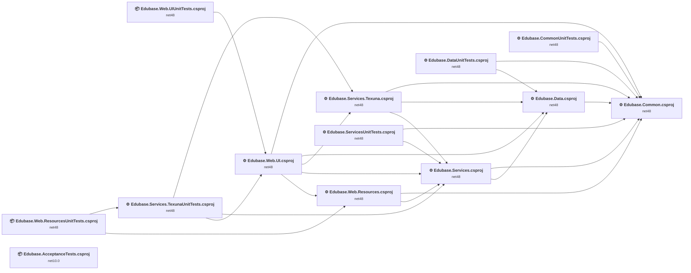

## Project Details

### Edubase.AcceptanceTests\Edubase.AcceptanceTests.csproj

#### Project Info

- **Current Target Framework:** net10.0✅
- **SDK-style**: True
- **Project Kind:** DotNetCoreApp
- **Dependencies**: 0
- **Dependants**: 0
- **Number of Files**: 30
- **Lines of Code**: 1337
- **Estimated LOC to modify**: 0+ (at least 0.0% of the project)

#### Dependency Graph

Legend:
📦 SDK-style project
⚙️ Classic project

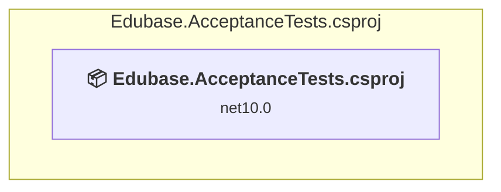

### API Compatibility

| Category | Count | Impact |
| :--- | :---: | :--- |
| 🔴 Binary Incompatible | 0 | High - Require code changes |
| 🟡 Source Incompatible | 0 | Medium - Needs re-compilation and potential conflicting API error fixing |
| 🔵 Behavioral change | 0 | Low - Behavioral changes that may require testing at runtime |
| ✅ Compatible | 0 |  |
| ***Total APIs Analyzed*** | ***0*** |  |

### Edubase.Common\Edubase.Common.csproj

#### Project Info

- **Current Target Framework:** net48
- **Proposed Target Framework:** net10.0
- **SDK-style**: False
- **Project Kind:** ClassicClassLibrary
- **Dependencies**: 0
- **Dependants**: 8
- **Number of Files**: 43
- **Number of Files with Incidents**: 10
- **Lines of Code**: 3600
- **Estimated LOC to modify**: 92+ (at least 2.6% of the project)

#### Dependency Graph

Legend:
📦 SDK-style project
⚙️ Classic project

```mermaid
flowchart TB
    subgraph upstream["Dependants (8)"]
        P1["<b>⚙️&nbsp;Edubase.Data.csproj</b><br/><small>net48</small>"]
        P2["<b>⚙️&nbsp;Edubase.Services.csproj</b><br/><small>net48</small>"]
        P4["<b>⚙️&nbsp;Edubase.Web.UI.csproj</b><br/><small>net48</small>"]
        P5["<b>⚙️&nbsp;Edubase.Services.Texuna.csproj</b><br/><small>net48</small>"]
        P6["<b>⚙️&nbsp;Edubase.Web.Resources.csproj</b><br/><small>net48</small>"]
        P7["<b>⚙️&nbsp;Edubase.CommonUnitTests.csproj</b><br/><small>net48</small>"]
        P8["<b>⚙️&nbsp;Edubase.DataUnitTests.csproj</b><br/><small>net48</small>"]
        P9["<b>⚙️&nbsp;Edubase.ServicesUnitTests.csproj</b><br/><small>net48</small>"]
        click P1 "#edubasedataedubasedatacsproj"
        click P2 "#edubaseservicesedubaseservicescsproj"
        click P4 "#edubasewebuiedubasewebuicsproj"
        click P5 "#edubaseservicestexunaedubaseservicestexunacsproj"
        click P6 "#edubasewebresourcesedubasewebresourcescsproj"
        click P7 "#edubasecommonunittestsedubasecommonunittestscsproj"
        click P8 "#edubasedataunittestsedubasedataunittestscsproj"
        click P9 "#edubaseservicesunittestsedubaseservicesunittestscsproj"
    end
    subgraph current["Edubase.Common.csproj"]
        MAIN["<b>⚙️&nbsp;Edubase.Common.csproj</b><br/><small>net48</small>"]
        click MAIN "#edubasecommonedubasecommoncsproj"
    end
    P1 --> MAIN
    P2 --> MAIN
    P4 --> MAIN
    P5 --> MAIN
    P6 --> MAIN
    P7 --> MAIN
    P8 --> MAIN
    P9 --> MAIN

```

### API Compatibility

| Category | Count | Impact |
| :--- | :---: | :--- |
| 🔴 Binary Incompatible | 7 | High - Require code changes |
| 🟡 Source Incompatible | 83 | Medium - Needs re-compilation and potential conflicting API error fixing |
| 🔵 Behavioral change | 2 | Low - Behavioral changes that may require testing at runtime |
| ✅ Compatible | 2790 |  |
| ***Total APIs Analyzed*** | ***2882*** |  |

#### Binding Redirect Configuration

| Rule | Severity | Details | Recommendation |
| :--- | :---: | :--- | :--- |
| Missing binding redirect for referenced assembly | 🟡Potential | Manual redirects exist but none covers AutoMapper (referenced v10.0.0.0, package v10.1.1) | Add a binding redirect for the missing assembly. |
| Missing binding redirect for referenced assembly | 🟡Potential | Manual redirects exist but none covers MoreLinq (referenced v3.3.2.0, package v3.3.2) | Add a binding redirect for the missing assembly. |
| Missing binding redirect for referenced assembly | 🟡Potential | Manual redirects exist but none covers Newtonsoft.Json.Bson (referenced v1.0.0.0, package v1.0.2) | Add a binding redirect for the missing assembly. |
| Missing binding redirect for referenced assembly | 🟡Potential | Manual redirects exist but none covers Pipelines.Sockets.Unofficial (referenced v1.0.0.0, package v2.2.8) | Add a binding redirect for the missing assembly. |
| Missing binding redirect for referenced assembly | 🟡Potential | Manual redirects exist but none covers StackExchange.Redis (referenced v2.0.0.0, package v2.1.28) | Add a binding redirect for the missing assembly. |
| Missing binding redirect for referenced assembly | 🟡Potential | Manual redirects exist but none covers System.Diagnostics.PerformanceCounter (referenced v8.0.0.0, package v8.0.0) | Add a binding redirect for the missing assembly. |
| Missing binding redirect for referenced assembly | 🟡Potential | Manual redirects exist but none covers System.IO.Compression (referenced v4.2.0.0, package v4.3.0) | Add a binding redirect for the missing assembly. |
| Manual redirect conflicts with auto-generated version | 🔴Mandatory | Manual redirect for System.ValueTuple targets 4.0.3.0 but auto-generation would target 4.5.0 (MSB3836 conflict) | Remove the conflicting manual binding redirect or disable auto-generation. |
| Manual redirect conflicts with auto-generated version | 🔴Mandatory | Manual redirect for System.Buffers targets 4.0.3.0 but auto-generation would target 4.5.1 (MSB3836 conflict) | Remove the conflicting manual binding redirect or disable auto-generation. |
| Manual redirect conflicts with auto-generated version | 🔴Mandatory | Manual redirect for System.Threading.Tasks.Extensions targets 4.2.0.1 but auto-generation would target 4.5.4 (MSB3836 conflict) | Remove the conflicting manual binding redirect or disable auto-generation. |
| Manual redirect conflicts with auto-generated version | 🔴Mandatory | Manual redirect for System.Numerics.Vectors targets 4.1.4.0 but auto-generation would target 4.5.0 (MSB3836 conflict) | Remove the conflicting manual binding redirect or disable auto-generation. |
| Manual redirect conflicts with auto-generated version | 🔴Mandatory | Manual redirect for System.Memory targets 4.0.1.2 but auto-generation would target 4.5.5 (MSB3836 conflict) | Remove the conflicting manual binding redirect or disable auto-generation. |
| Manual redirect conflicts with auto-generated version | 🔴Mandatory | Manual redirect for Newtonsoft.Json targets 13.0.0.0 but auto-generation would target 13.0.3 (MSB3836 conflict) | Remove the conflicting manual binding redirect or disable auto-generation. |
| Binding redirect forces version downgrade | 🟡Potential | Binding redirect for Newtonsoft.Json targets 13.0.0.0 but package provides 13.0.3 | Update the binding redirect newVersion to match the version provided by the NuGet package. |
| Binding redirect forces version downgrade | 🟡Potential | Binding redirect for System.Buffers targets 4.0.3.0 but package provides 4.5.1 | Update the binding redirect newVersion to match the version provided by the NuGet package. |
| Binding redirect forces version downgrade | 🟡Potential | Binding redirect for System.Memory targets 4.0.1.2 but package provides 4.5.5 | Update the binding redirect newVersion to match the version provided by the NuGet package. |
| Binding redirect forces version downgrade | 🟡Potential | Binding redirect for System.Numerics.Vectors targets 4.1.4.0 but package provides 4.5.0 | Update the binding redirect newVersion to match the version provided by the NuGet package. |
| Binding redirect forces version downgrade | 🟡Potential | Binding redirect for System.Threading.Tasks.Extensions targets 4.2.0.1 but package provides 4.5.4 | Update the binding redirect newVersion to match the version provided by the NuGet package. |
| Binding redirect forces version downgrade | 🟡Potential | Binding redirect for System.ValueTuple targets 4.0.3.0 but package provides 4.5.0 | Update the binding redirect newVersion to match the version provided by the NuGet package. |

#### Project Technologies and Features

| Technology | Issues | Percentage | Migration Path |
| :--- | :---: | :---: | :--- |
| Legacy Configuration System | 26 | 28.3% | Legacy XML-based configuration system (app.config/web.config) that has been replaced by a more flexible configuration model in .NET Core. The old system was rigid and XML-based. Migrate to Microsoft.Extensions.Configuration with JSON/environment variables; use System.Configuration.ConfigurationManager NuGet package as interim bridge if needed. |
| ASP.NET Framework (System.Web) | 6 | 6.5% | Legacy ASP.NET Framework APIs for web applications (System.Web.*) that don't exist in ASP.NET Core due to architectural differences. ASP.NET Core represents a complete redesign of the web framework. Migrate to ASP.NET Core equivalents or consider System.Web.Adapters package for compatibility. |

### Edubase.CommonUnitTests\Edubase.CommonUnitTests.csproj

#### Project Info

- **Current Target Framework:** net48
- **Proposed Target Framework:** net10.0
- **SDK-style**: False
- **Project Kind:** ClassicClassLibrary
- **Dependencies**: 1
- **Dependants**: 0
- **Number of Files**: 4
- **Number of Files with Incidents**: 2
- **Lines of Code**: 182
- **Estimated LOC to modify**: 6+ (at least 3.3% of the project)

#### Dependency Graph

Legend:
📦 SDK-style project
⚙️ Classic project

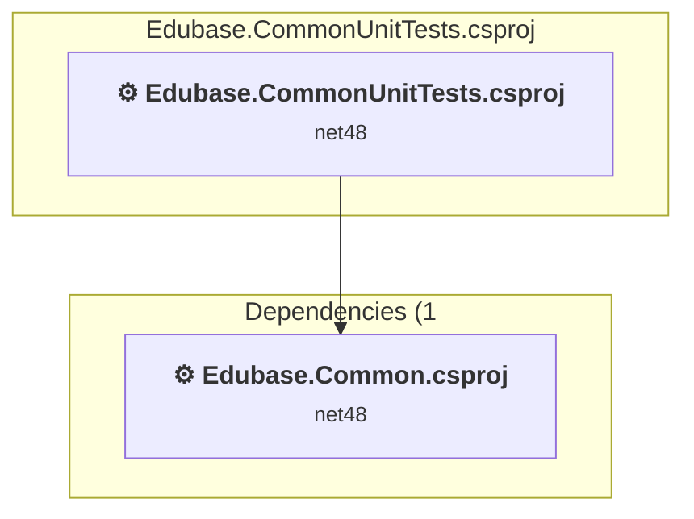

### API Compatibility

| Category | Count | Impact |
| :--- | :---: | :--- |
| 🔴 Binary Incompatible | 0 | High - Require code changes |
| 🟡 Source Incompatible | 6 | Medium - Needs re-compilation and potential conflicting API error fixing |
| 🔵 Behavioral change | 0 | Low - Behavioral changes that may require testing at runtime |
| ✅ Compatible | 208 |  |
| ***Total APIs Analyzed*** | ***214*** |  |

#### Project Technologies and Features

| Technology | Issues | Percentage | Migration Path |
| :--- | :---: | :---: | :--- |
| Legacy Configuration System | 6 | 100.0% | Legacy XML-based configuration system (app.config/web.config) that has been replaced by a more flexible configuration model in .NET Core. The old system was rigid and XML-based. Migrate to Microsoft.Extensions.Configuration with JSON/environment variables; use System.Configuration.ConfigurationManager NuGet package as interim bridge if needed. |

### Edubase.Data\Edubase.Data.csproj

#### Project Info

- **Current Target Framework:** net48
- **Proposed Target Framework:** net10.0
- **SDK-style**: False
- **Project Kind:** ClassicClassLibrary
- **Dependencies**: 1
- **Dependants**: 4
- **Number of Files**: 60
- **Number of Files with Incidents**: 5
- **Lines of Code**: 3145
- **Estimated LOC to modify**: 58+ (at least 1.8% of the project)

#### Dependency Graph

Legend:
📦 SDK-style project
⚙️ Classic project

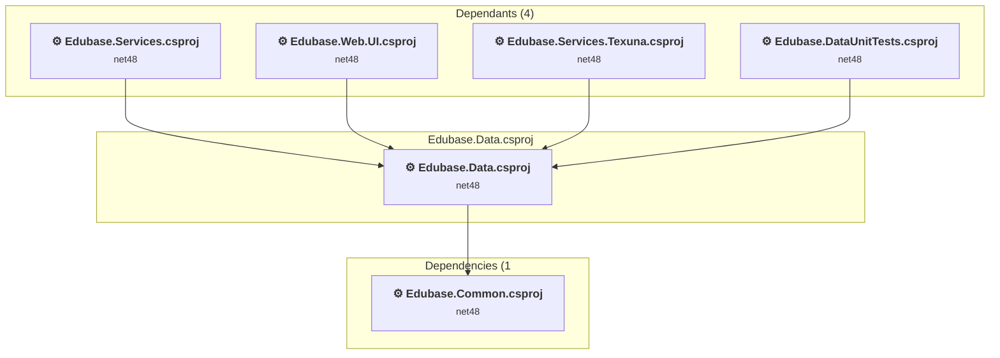

### API Compatibility

| Category | Count | Impact |
| :--- | :---: | :--- |
| 🔴 Binary Incompatible | 6 | High - Require code changes |
| 🟡 Source Incompatible | 52 | Medium - Needs re-compilation and potential conflicting API error fixing |
| 🔵 Behavioral change | 0 | Low - Behavioral changes that may require testing at runtime |
| ✅ Compatible | 4134 |  |
| ***Total APIs Analyzed*** | ***4192*** |  |

#### Binding Redirect Configuration

| Rule | Severity | Details | Recommendation |
| :--- | :---: | :--- | :--- |
| Missing binding redirect for referenced assembly | 🟡Potential | Manual redirects exist but none covers EntityFramework (referenced v6.0.0.0, package v6.5.1) | Add a binding redirect for the missing assembly. |
| Missing binding redirect for referenced assembly | 🟡Potential | Manual redirects exist but none covers FluentValidation (referenced v11.0.0.0, package v11.9.2) | Add a binding redirect for the missing assembly. |
| Missing binding redirect for referenced assembly | 🟡Potential | Manual redirects exist but none covers Microsoft.AspNet.Identity.Core (referenced v2.0.0.0, package v2.2.4) | Add a binding redirect for the missing assembly. |
| Missing binding redirect for referenced assembly | 🟡Potential | Manual redirects exist but none covers Microsoft.AspNet.Identity.Owin (referenced v2.0.0.0, package v2.2.4) | Add a binding redirect for the missing assembly. |
| Missing binding redirect for referenced assembly | 🟡Potential | Manual redirects exist but none covers Microsoft.Rest.ClientRuntime (referenced v2.0.0.0, package v2.3.24) | Add a binding redirect for the missing assembly. |
| Missing binding redirect for referenced assembly | 🟡Potential | Manual redirects exist but none covers Microsoft.Rest.ClientRuntime.Azure (referenced v3.0.0.0, package v3.3.19) | Add a binding redirect for the missing assembly. |
| Missing binding redirect for referenced assembly | 🟡Potential | Manual redirects exist but none covers MoreLinq (referenced v3.3.2.0, package v3.3.2) | Add a binding redirect for the missing assembly. |
| Missing binding redirect for referenced assembly | 🟡Potential | Manual redirects exist but none covers Newtonsoft.Json.Bson (referenced v1.0.0.0, package v1.0.2) | Add a binding redirect for the missing assembly. |
| Missing binding redirect for referenced assembly | 🟡Potential | Manual redirects exist but none covers Owin (referenced v1.0.0.0, package v1.0) | Add a binding redirect for the missing assembly. |
| Manual redirect conflicts with auto-generated version | 🔴Mandatory | Manual redirect for Newtonsoft.Json targets 13.0.0.0 but auto-generation would target 13.0.3 (MSB3836 conflict) | Remove the conflicting manual binding redirect or disable auto-generation. |
| Manual redirect conflicts with auto-generated version | 🔴Mandatory | Manual redirect for System.ValueTuple targets 4.0.3.0 but auto-generation would target 4.5.0 (MSB3836 conflict) | Remove the conflicting manual binding redirect or disable auto-generation. |
| Manual redirect conflicts with auto-generated version | 🔴Mandatory | Manual redirect for System.Runtime.CompilerServices.Unsafe targets 6.0.0.0 but auto-generation would target 4.5.3 (MSB3836 conflict) | Remove the conflicting manual binding redirect or disable auto-generation. |
| Manual redirect conflicts with auto-generated version | 🔴Mandatory | Manual redirect for System.Threading.Tasks.Extensions targets 4.2.0.1 but auto-generation would target 4.5.4 (MSB3836 conflict) | Remove the conflicting manual binding redirect or disable auto-generation. |
| Binding redirect forces version downgrade | 🟡Potential | Binding redirect for Newtonsoft.Json targets 13.0.0.0 but package provides 13.0.3 | Update the binding redirect newVersion to match the version provided by the NuGet package. |
| Binding redirect forces version downgrade | 🟡Potential | Binding redirect for System.Threading.Tasks.Extensions targets 4.2.0.1 but package provides 4.5.4 | Update the binding redirect newVersion to match the version provided by the NuGet package. |
| Binding redirect forces version downgrade | 🟡Potential | Binding redirect for System.ValueTuple targets 4.0.3.0 but package provides 4.5.0 | Update the binding redirect newVersion to match the version provided by the NuGet package. |

#### Project Technologies and Features

| Technology | Issues | Percentage | Migration Path |
| :--- | :---: | :---: | :--- |
| Legacy Data Access | 6 | 10.3% | LINQ to SQL and deprecated ADO.NET components that have been superseded by more modern data access technologies. LINQ to SQL was an early ORM that has been replaced by Entity Framework. Migrate to Entity Framework Core or modern ADO.NET. |
| Legacy Configuration System | 20 | 34.5% | Legacy XML-based configuration system (app.config/web.config) that has been replaced by a more flexible configuration model in .NET Core. The old system was rigid and XML-based. Migrate to Microsoft.Extensions.Configuration with JSON/environment variables; use System.Configuration.ConfigurationManager NuGet package as interim bridge if needed. |

### Edubase.DataUnitTests\Edubase.DataUnitTests.csproj

#### Project Info

- **Current Target Framework:** net48
- **Proposed Target Framework:** net10.0
- **SDK-style**: False
- **Project Kind:** ClassicClassLibrary
- **Dependencies**: 2
- **Dependants**: 0
- **Number of Files**: 2
- **Number of Files with Incidents**: 1
- **Lines of Code**: 60
- **Estimated LOC to modify**: 0+ (at least 0.0% of the project)

#### Dependency Graph

Legend:
📦 SDK-style project
⚙️ Classic project

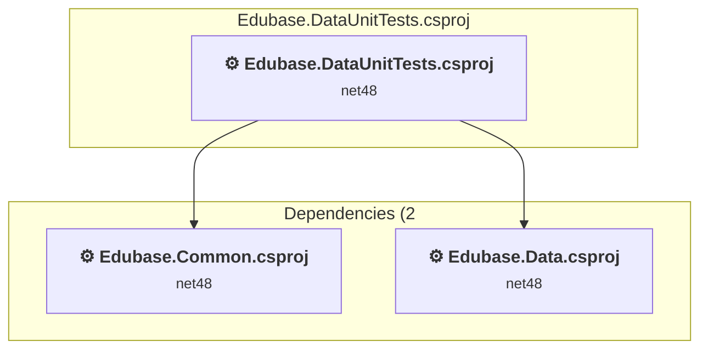

### API Compatibility

| Category | Count | Impact |
| :--- | :---: | :--- |
| 🔴 Binary Incompatible | 0 | High - Require code changes |
| 🟡 Source Incompatible | 0 | Medium - Needs re-compilation and potential conflicting API error fixing |
| 🔵 Behavioral change | 0 | Low - Behavioral changes that may require testing at runtime |
| ✅ Compatible | 16 |  |
| ***Total APIs Analyzed*** | ***16*** |  |

### Edubase.Services.Texuna\Edubase.Services.Texuna.csproj

#### Project Info

- **Current Target Framework:** net48
- **Proposed Target Framework:** net10.0
- **SDK-style**: False
- **Project Kind:** ClassicClassLibrary
- **Dependencies**: 3
- **Dependants**: 2
- **Number of Files**: 34
- **Number of Files with Incidents**: 5
- **Lines of Code**: 2864
- **Estimated LOC to modify**: 82+ (at least 2.9% of the project)

#### Dependency Graph

Legend:
📦 SDK-style project
⚙️ Classic project

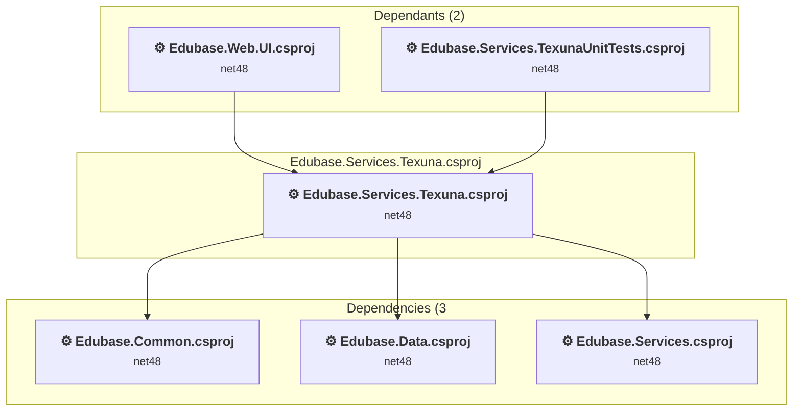

### API Compatibility

| Category | Count | Impact |
| :--- | :---: | :--- |
| 🔴 Binary Incompatible | 6 | High - Require code changes |
| 🟡 Source Incompatible | 38 | Medium - Needs re-compilation and potential conflicting API error fixing |
| 🔵 Behavioral change | 38 | Low - Behavioral changes that may require testing at runtime |
| ✅ Compatible | 3117 |  |
| ***Total APIs Analyzed*** | ***3199*** |  |

#### Binding Redirect Configuration

| Rule | Severity | Details | Recommendation |
| :--- | :---: | :--- | :--- |
| Missing binding redirect for referenced assembly | 🟡Potential | Manual redirects exist but none covers Microsoft.AspNet.Identity.Core (referenced v2.0.0.0, package v2.2.3) | Add a binding redirect for the missing assembly. |
| Missing binding redirect for referenced assembly | 🟡Potential | Manual redirects exist but none covers MoreLinq (referenced v3.3.2.0, package v3.3.2) | Add a binding redirect for the missing assembly. |
| Missing binding redirect for referenced assembly | 🟡Potential | Manual redirects exist but none covers Newtonsoft.Json.Bson (referenced v1.0.0.0, package v1.0.2) | Add a binding redirect for the missing assembly. |
| Manual redirect conflicts with auto-generated version | 🔴Mandatory | Manual redirect for Newtonsoft.Json targets 13.0.0.0 but auto-generation would target 13.0.3 (MSB3836 conflict) | Remove the conflicting manual binding redirect or disable auto-generation. |
| Manual redirect conflicts with auto-generated version | 🔴Mandatory | Manual redirect for System.ValueTuple targets 4.0.3.0 but auto-generation would target 4.5.0 (MSB3836 conflict) | Remove the conflicting manual binding redirect or disable auto-generation. |
| Manual redirect conflicts with auto-generated version | 🔴Mandatory | Manual redirect for System.Runtime.CompilerServices.Unsafe targets 6.0.0.0 but auto-generation would target 4.5.3 (MSB3836 conflict) | Remove the conflicting manual binding redirect or disable auto-generation. |
| Manual redirect conflicts with auto-generated version | 🔴Mandatory | Manual redirect for System.Buffers targets 4.0.3.0 but auto-generation would target 4.5.1 (MSB3836 conflict) | Remove the conflicting manual binding redirect or disable auto-generation. |
| Manual redirect conflicts with auto-generated version | 🔴Mandatory | Manual redirect for System.Threading.Tasks.Extensions targets 4.2.0.1 but auto-generation would target 4.5.4 (MSB3836 conflict) | Remove the conflicting manual binding redirect or disable auto-generation. |
| Manual redirect conflicts with auto-generated version | 🔴Mandatory | Manual redirect for System.Numerics.Vectors targets 4.1.4.0 but auto-generation would target 4.5.0 (MSB3836 conflict) | Remove the conflicting manual binding redirect or disable auto-generation. |
| Manual redirect conflicts with auto-generated version | 🔴Mandatory | Manual redirect for System.Memory targets 4.0.1.2 but auto-generation would target 4.5.5 (MSB3836 conflict) | Remove the conflicting manual binding redirect or disable auto-generation. |
| Binding redirect forces version downgrade | 🟡Potential | Binding redirect for System.Buffers targets 4.0.3.0 but package provides 4.5.1 | Update the binding redirect newVersion to match the version provided by the NuGet package. |
| Binding redirect forces version downgrade | 🟡Potential | Binding redirect for System.Memory targets 4.0.1.2 but package provides 4.5.5 | Update the binding redirect newVersion to match the version provided by the NuGet package. |
| Binding redirect forces version downgrade | 🟡Potential | Binding redirect for System.Numerics.Vectors targets 4.1.4.0 but package provides 4.5.0 | Update the binding redirect newVersion to match the version provided by the NuGet package. |
| Binding redirect forces version downgrade | 🟡Potential | Binding redirect for System.Threading.Tasks.Extensions targets 4.2.0.1 but package provides 4.5.4 | Update the binding redirect newVersion to match the version provided by the NuGet package. |
| Binding redirect forces version downgrade | 🟡Potential | Binding redirect for Newtonsoft.Json targets 13.0.0.0 but package provides 13.0.3 | Update the binding redirect newVersion to match the version provided by the NuGet package. |
| Binding redirect forces version downgrade | 🟡Potential | Binding redirect for System.ValueTuple targets 4.0.3.0 but package provides 4.5.0 | Update the binding redirect newVersion to match the version provided by the NuGet package. |

#### Project Technologies and Features

| Technology | Issues | Percentage | Migration Path |
| :--- | :---: | :---: | :--- |
| ASP.NET Framework (System.Web) | 9 | 11.0% | Legacy ASP.NET Framework APIs for web applications (System.Web.*) that don't exist in ASP.NET Core due to architectural differences. ASP.NET Core represents a complete redesign of the web framework. Migrate to ASP.NET Core equivalents or consider System.Web.Adapters package for compatibility. |
| Legacy Configuration System | 10 | 12.2% | Legacy XML-based configuration system (app.config/web.config) that has been replaced by a more flexible configuration model in .NET Core. The old system was rigid and XML-based. Migrate to Microsoft.Extensions.Configuration with JSON/environment variables; use System.Configuration.ConfigurationManager NuGet package as interim bridge if needed. |

### Edubase.Services.TexunaUnitTests\Edubase.Services.TexunaUnitTests.csproj

#### Project Info

- **Current Target Framework:** net48
- **Proposed Target Framework:** net10.0
- **SDK-style**: False
- **Project Kind:** ClassicClassLibrary
- **Dependencies**: 3
- **Dependants**: 1
- **Number of Files**: 6
- **Number of Files with Incidents**: 4
- **Lines of Code**: 1233
- **Estimated LOC to modify**: 24+ (at least 1.9% of the project)

#### Dependency Graph

Legend:
📦 SDK-style project
⚙️ Classic project

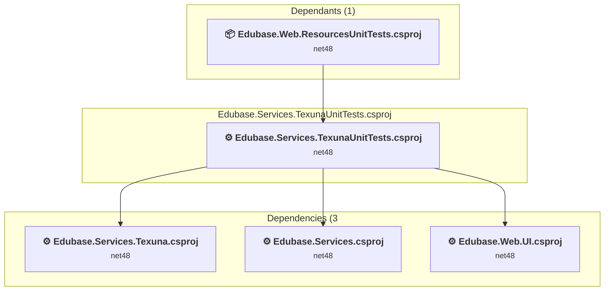

### API Compatibility

| Category | Count | Impact |
| :--- | :---: | :--- |
| 🔴 Binary Incompatible | 0 | High - Require code changes |
| 🟡 Source Incompatible | 1 | Medium - Needs re-compilation and potential conflicting API error fixing |
| 🔵 Behavioral change | 23 | Low - Behavioral changes that may require testing at runtime |
| ✅ Compatible | 1958 |  |
| ***Total APIs Analyzed*** | ***1982*** |  |

#### Binding Redirect Configuration

| Rule | Severity | Details | Recommendation |
| :--- | :---: | :--- | :--- |
| Missing binding redirect for referenced assembly | 🟡Potential | Manual redirects exist but none covers Castle.Core (referenced v5.0.0.0, package v5.1.1) | Add a binding redirect for the missing assembly. |
| Missing binding redirect for referenced assembly | 🟡Potential | Manual redirects exist but none covers Moq (referenced v4.18.0.0, package v4.18.2) | Add a binding redirect for the missing assembly. |
| Missing binding redirect for referenced assembly | 🟡Potential | Manual redirects exist but none covers Newtonsoft.Json.Bson (referenced v1.0.0.0, package v1.0.2) | Add a binding redirect for the missing assembly. |
| Missing binding redirect for referenced assembly | 🟡Potential | Manual redirects exist but none covers System.Collections.Immutable (referenced v8.0.0.0, package v8.0.0) | Add a binding redirect for the missing assembly. |
| Missing binding redirect for referenced assembly | 🟡Potential | Manual redirects exist but none covers xunit.abstractions (referenced v2.0.0.0, package v2.0.3) | Add a binding redirect for the missing assembly. |
| Missing binding redirect for referenced assembly | 🟡Potential | Manual redirects exist but none covers xunit.assert (referenced v2.9.0.0, package v2.9.0) | Add a binding redirect for the missing assembly. |
| Missing binding redirect for referenced assembly | 🟡Potential | Manual redirects exist but none covers xunit.core (referenced v2.9.0.0, package v2.9.0) | Add a binding redirect for the missing assembly. |
| Manual redirect conflicts with auto-generated version | 🔴Mandatory | Manual redirect for Newtonsoft.Json targets 13.0.0.0 but auto-generation would target 13.0.3 (MSB3836 conflict) | Remove the conflicting manual binding redirect or disable auto-generation. |
| Manual redirect conflicts with auto-generated version | 🔴Mandatory | Manual redirect for System.Threading.Tasks.Extensions targets 4.2.0.1 but auto-generation would target 4.5.4 (MSB3836 conflict) | Remove the conflicting manual binding redirect or disable auto-generation. |
| Manual redirect conflicts with auto-generated version | 🔴Mandatory | Manual redirect for System.Numerics.Vectors targets 4.1.4.0 but auto-generation would target 4.5.0 (MSB3836 conflict) | Remove the conflicting manual binding redirect or disable auto-generation. |
| Manual redirect conflicts with auto-generated version | 🔴Mandatory | Manual redirect for System.Buffers targets 4.0.3.0 but auto-generation would target 4.5.1 (MSB3836 conflict) | Remove the conflicting manual binding redirect or disable auto-generation. |
| Manual redirect conflicts with auto-generated version | 🔴Mandatory | Manual redirect for System.Memory targets 4.0.1.2 but auto-generation would target 4.5.5 (MSB3836 conflict) | Remove the conflicting manual binding redirect or disable auto-generation. |
| Binding redirect forces version downgrade | 🟡Potential | Binding redirect for System.Buffers targets 4.0.3.0 but package provides 4.5.1 | Update the binding redirect newVersion to match the version provided by the NuGet package. |
| Binding redirect forces version downgrade | 🟡Potential | Binding redirect for System.Memory targets 4.0.1.2 but package provides 4.5.5 | Update the binding redirect newVersion to match the version provided by the NuGet package. |
| Binding redirect forces version downgrade | 🟡Potential | Binding redirect for System.Numerics.Vectors targets 4.1.4.0 but package provides 4.5.0 | Update the binding redirect newVersion to match the version provided by the NuGet package. |
| Binding redirect forces version downgrade | 🟡Potential | Binding redirect for Newtonsoft.Json targets 13.0.0.0 but package provides 13.0.3 | Update the binding redirect newVersion to match the version provided by the NuGet package. |
| Binding redirect forces version downgrade | 🟡Potential | Binding redirect for System.Threading.Tasks.Extensions targets 4.2.0.1 but package provides 4.5.4 | Update the binding redirect newVersion to match the version provided by the NuGet package. |

### Edubase.Services\Edubase.Services.csproj

#### Project Info

- **Current Target Framework:** net48
- **Proposed Target Framework:** net10.0
- **SDK-style**: False
- **Project Kind:** ClassicClassLibrary
- **Dependencies**: 2
- **Dependants**: 5
- **Number of Files**: 188
- **Number of Files with Incidents**: 15
- **Lines of Code**: 7155
- **Estimated LOC to modify**: 94+ (at least 1.3% of the project)

#### Dependency Graph

Legend:
📦 SDK-style project
⚙️ Classic project

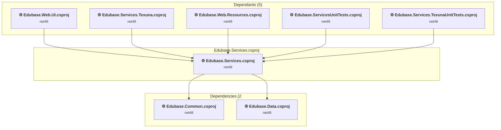

### API Compatibility

| Category | Count | Impact |
| :--- | :---: | :--- |
| 🔴 Binary Incompatible | 4 | High - Require code changes |
| 🟡 Source Incompatible | 73 | Medium - Needs re-compilation and potential conflicting API error fixing |
| 🔵 Behavioral change | 17 | Low - Behavioral changes that may require testing at runtime |
| ✅ Compatible | 9460 |  |
| ***Total APIs Analyzed*** | ***9554*** |  |

#### Binding Redirect Configuration

| Rule | Severity | Details | Recommendation |
| :--- | :---: | :--- | :--- |
| Missing binding redirect for referenced assembly | 🟡Potential | Manual redirects exist but none covers CompaniesHouse (referenced v1.0.0.0, package v8.0.29) | Add a binding redirect for the missing assembly. |
| Missing binding redirect for referenced assembly | 🟡Potential | Manual redirects exist but none covers Microsoft.Bcl.TimeProvider (referenced v8.0.0.0, package v8.0.0) | Add a binding redirect for the missing assembly. |
| Missing binding redirect for referenced assembly | 🟡Potential | Manual redirects exist but none covers Newtonsoft.Json.Bson (referenced v1.0.0.0, package v1.0.2) | Add a binding redirect for the missing assembly. |
| Missing binding redirect for referenced assembly | 🟡Potential | Manual redirects exist but none covers Polly (referenced v8.0.0.0, package v8.4.1) | Add a binding redirect for the missing assembly. |
| Missing binding redirect for referenced assembly | 🟡Potential | Manual redirects exist but none covers Polly.Core (referenced v8.0.0.0, package v8.4.1) | Add a binding redirect for the missing assembly. |
| Missing binding redirect for referenced assembly | 🟡Potential | Manual redirects exist but none covers System.ComponentModel.Annotations (referenced v4.2.1.0, package v4.5.0) | Add a binding redirect for the missing assembly. |
| Manual redirect conflicts with auto-generated version | 🔴Mandatory | Manual redirect for Newtonsoft.Json targets 13.0.0.0 but auto-generation would target 13.0.3 (MSB3836 conflict) | Remove the conflicting manual binding redirect or disable auto-generation. |
| Manual redirect conflicts with auto-generated version | 🔴Mandatory | Manual redirect for System.ValueTuple targets 4.0.3.0 but auto-generation would target 4.5.0 (MSB3836 conflict) | Remove the conflicting manual binding redirect or disable auto-generation. |
| Manual redirect conflicts with auto-generated version | 🔴Mandatory | Manual redirect for System.Runtime.CompilerServices.Unsafe targets 6.0.0.0 but auto-generation would target 4.5.3 (MSB3836 conflict) | Remove the conflicting manual binding redirect or disable auto-generation. |
| Manual redirect conflicts with auto-generated version | 🔴Mandatory | Manual redirect for System.Buffers targets 4.0.3.0 but auto-generation would target 4.5.1 (MSB3836 conflict) | Remove the conflicting manual binding redirect or disable auto-generation. |
| Manual redirect conflicts with auto-generated version | 🔴Mandatory | Manual redirect for System.Numerics.Vectors targets 4.1.4.0 but auto-generation would target 4.5.0 (MSB3836 conflict) | Remove the conflicting manual binding redirect or disable auto-generation. |
| Manual redirect conflicts with auto-generated version | 🔴Mandatory | Manual redirect for System.Threading.Tasks.Extensions targets 4.2.0.1 but auto-generation would target 4.5.4 (MSB3836 conflict) | Remove the conflicting manual binding redirect or disable auto-generation. |
| Manual redirect conflicts with auto-generated version | 🔴Mandatory | Manual redirect for System.Memory targets 4.0.1.2 but auto-generation would target 4.5.5 (MSB3836 conflict) | Remove the conflicting manual binding redirect or disable auto-generation. |
| Binding redirect forces version downgrade | 🟡Potential | Binding redirect for Microsoft.WindowsAzure.Storage targets 9.1.0.0 but reference requires 9.3.2.0 | Update the binding redirect newVersion to match the version provided by the NuGet package. |
| Assembly version mismatch with insufficient redirect coverage | 🔴Mandatory | Redirect for Microsoft.WindowsAzure.Storage has oldVersion="0.0.0.0-9.1.0.0" which does not cover referenced version 9.3.2.0 | Add or update binding redirect with oldVersion="0.0.0.0-{TargetVersion}" newVersion="{TargetVersion}". |
| Binding redirect forces version downgrade | 🟡Potential | Binding redirect for Newtonsoft.Json targets 13.0.0.0 but package provides 13.0.3 | Update the binding redirect newVersion to match the version provided by the NuGet package. |
| Binding redirect forces version downgrade | 🟡Potential | Binding redirect for System.Buffers targets 4.0.3.0 but package provides 4.5.1 | Update the binding redirect newVersion to match the version provided by the NuGet package. |
| Binding redirect forces version downgrade | 🟡Potential | Binding redirect for System.Memory targets 4.0.1.2 but package provides 4.5.5 | Update the binding redirect newVersion to match the version provided by the NuGet package. |
| Binding redirect forces version downgrade | 🟡Potential | Binding redirect for System.Numerics.Vectors targets 4.1.4.0 but package provides 4.5.0 | Update the binding redirect newVersion to match the version provided by the NuGet package. |
| Binding redirect forces version downgrade | 🟡Potential | Binding redirect for System.Threading.Tasks.Extensions targets 4.2.0.1 but package provides 4.5.4 | Update the binding redirect newVersion to match the version provided by the NuGet package. |
| Binding redirect forces version downgrade | 🟡Potential | Binding redirect for System.ValueTuple targets 4.0.3.0 but package provides 4.5.0 | Update the binding redirect newVersion to match the version provided by the NuGet package. |

#### Project Technologies and Features

| Technology | Issues | Percentage | Migration Path |
| :--- | :---: | :---: | :--- |
| Legacy Configuration System | 22 | 23.4% | Legacy XML-based configuration system (app.config/web.config) that has been replaced by a more flexible configuration model in .NET Core. The old system was rigid and XML-based. Migrate to Microsoft.Extensions.Configuration with JSON/environment variables; use System.Configuration.ConfigurationManager NuGet package as interim bridge if needed. |

### Edubase.ServicesUnitTests\Edubase.ServicesUnitTests.csproj

#### Project Info

- **Current Target Framework:** net48
- **Proposed Target Framework:** net10.0
- **SDK-style**: False
- **Project Kind:** ClassicClassLibrary
- **Dependencies**: 2
- **Dependants**: 0
- **Number of Files**: 5
- **Number of Files with Incidents**: 4
- **Lines of Code**: 917
- **Estimated LOC to modify**: 49+ (at least 5.3% of the project)

#### Dependency Graph

Legend:
📦 SDK-style project
⚙️ Classic project

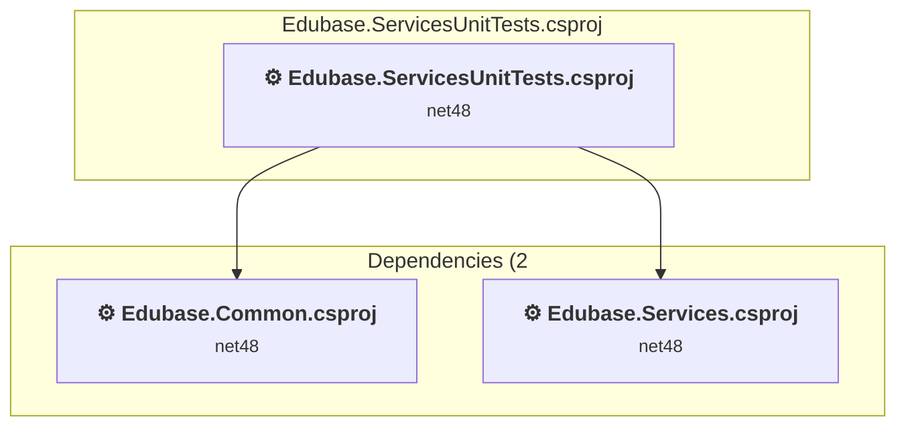

### API Compatibility

| Category | Count | Impact |
| :--- | :---: | :--- |
| 🔴 Binary Incompatible | 0 | High - Require code changes |
| 🟡 Source Incompatible | 44 | Medium - Needs re-compilation and potential conflicting API error fixing |
| 🔵 Behavioral change | 5 | Low - Behavioral changes that may require testing at runtime |
| ✅ Compatible | 1285 |  |
| ***Total APIs Analyzed*** | ***1334*** |  |

#### Project Technologies and Features

| Technology | Issues | Percentage | Migration Path |
| :--- | :---: | :---: | :--- |
| Legacy Configuration System | 28 | 57.1% | Legacy XML-based configuration system (app.config/web.config) that has been replaced by a more flexible configuration model in .NET Core. The old system was rigid and XML-based. Migrate to Microsoft.Extensions.Configuration with JSON/environment variables; use System.Configuration.ConfigurationManager NuGet package as interim bridge if needed. |

### Edubase.Web.Resources\Edubase.Web.Resources.csproj

#### Project Info

- **Current Target Framework:** net48
- **Proposed Target Framework:** net10.0
- **SDK-style**: False
- **Project Kind:** ClassicClassLibrary
- **Dependencies**: 2
- **Dependants**: 2
- **Number of Files**: 13
- **Number of Files with Incidents**: 1
- **Lines of Code**: 549
- **Estimated LOC to modify**: 0+ (at least 0.0% of the project)

#### Dependency Graph

Legend:
📦 SDK-style project
⚙️ Classic project

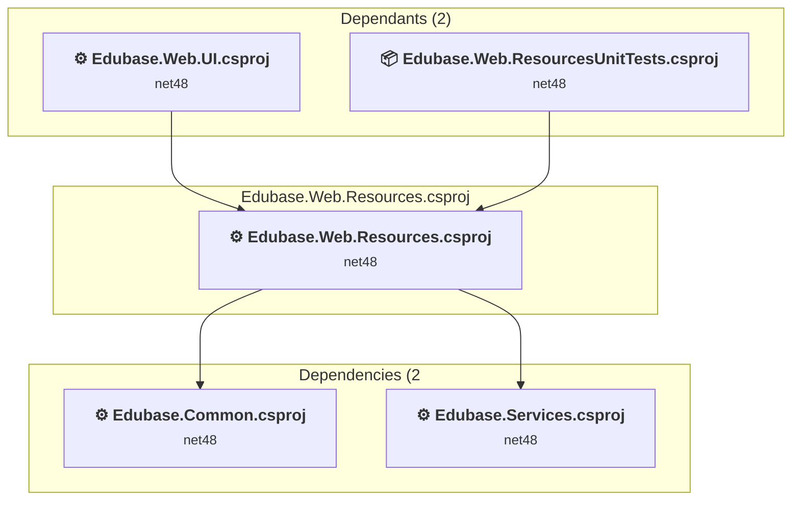

### API Compatibility

| Category | Count | Impact |
| :--- | :---: | :--- |
| 🔴 Binary Incompatible | 0 | High - Require code changes |
| 🟡 Source Incompatible | 0 | Medium - Needs re-compilation and potential conflicting API error fixing |
| 🔵 Behavioral change | 0 | Low - Behavioral changes that may require testing at runtime |
| ✅ Compatible | 274 |  |
| ***Total APIs Analyzed*** | ***274*** |  |

### Edubase.Web.ResourcesUnitTests\Edubase.Web.ResourcesUnitTests.csproj

#### Project Info

- **Current Target Framework:** net48
- **Proposed Target Framework:** net10.0
- **SDK-style**: True
- **Project Kind:** ClassLibrary
- **Dependencies**: 2
- **Dependants**: 0
- **Number of Files**: 2
- **Number of Files with Incidents**: 1
- **Lines of Code**: 101
- **Estimated LOC to modify**: 0+ (at least 0.0% of the project)

#### Dependency Graph

Legend:
📦 SDK-style project
⚙️ Classic project

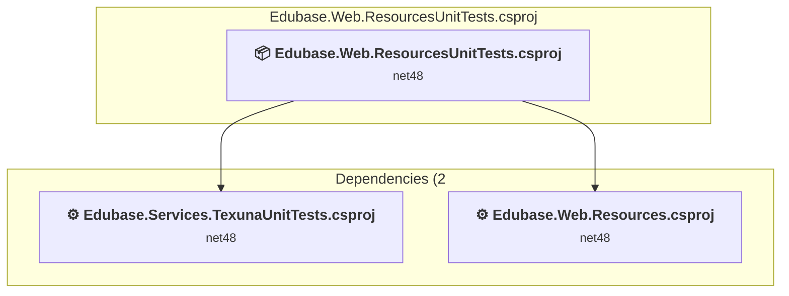

### API Compatibility

| Category | Count | Impact |
| :--- | :---: | :--- |
| 🔴 Binary Incompatible | 0 | High - Require code changes |
| 🟡 Source Incompatible | 0 | Medium - Needs re-compilation and potential conflicting API error fixing |
| 🔵 Behavioral change | 0 | Low - Behavioral changes that may require testing at runtime |
| ✅ Compatible | 104 |  |
| ***Total APIs Analyzed*** | ***104*** |  |

### Edubase.Web.UI\Edubase.Web.UI.csproj

#### Project Info

- **Current Target Framework:** net48
- **Proposed Target Framework:** net10.0
- **SDK-style**: False
- **Project Kind:** Wap
- **Dependencies**: 5
- **Dependants**: 2
- **Number of Files**: 743
- **Number of Files with Incidents**: 120
- **Lines of Code**: 52509
- **Estimated LOC to modify**: 5941+ (at least 11.3% of the project)

#### Dependency Graph

Legend:
📦 SDK-style project
⚙️ Classic project

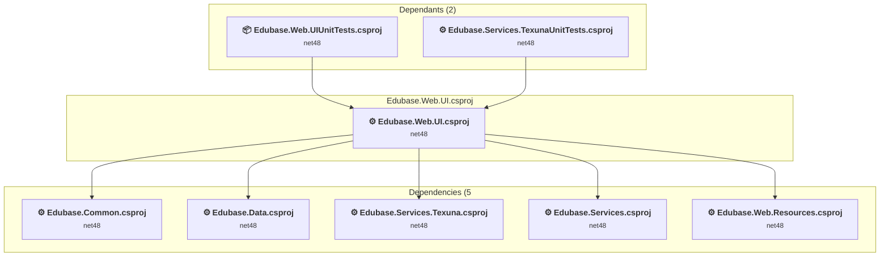

### API Compatibility

| Category | Count | Impact |
| :--- | :---: | :--- |
| 🔴 Binary Incompatible | 5204 | High - Require code changes |
| 🟡 Source Incompatible | 623 | Medium - Needs re-compilation and potential conflicting API error fixing |
| 🔵 Behavioral change | 114 | Low - Behavioral changes that may require testing at runtime |
| ✅ Compatible | 30560 |  |
| ***Total APIs Analyzed*** | ***36501*** |  |

#### Binding Redirect Configuration

| Rule | Severity | Details | Recommendation |
| :--- | :---: | :--- | :--- |
| Missing binding redirect for referenced assembly | 🟡Potential | Manual redirects exist but none covers AutoMapper (referenced v10.0.0.0, package v10.1.1) | Add a binding redirect for the missing assembly. |
| Missing binding redirect for referenced assembly | 🟡Potential | Manual redirects exist but none covers Azure.Core (referenced v1.50.0.0, package v1.50.0) | Add a binding redirect for the missing assembly. |
| Missing binding redirect for referenced assembly | 🟡Potential | Manual redirects exist but none covers Azure.Identity (referenced v1.17.1.0, package v1.17.1) | Add a binding redirect for the missing assembly. |
| Missing binding redirect for referenced assembly | 🟡Potential | Manual redirects exist but none covers AzureTableLogger (referenced v1.0.0.0, package v1.1.3) | Add a binding redirect for the missing assembly. |
| Missing binding redirect for referenced assembly | 🟡Potential | Manual redirects exist but none covers Castle.Core (referenced v5.0.0.0, package v5.1.1) | Add a binding redirect for the missing assembly. |
| Missing binding redirect for referenced assembly | 🟡Potential | Manual redirects exist but none covers CsvHelper (referenced v33.0.0.0, package v33.0.1) | Add a binding redirect for the missing assembly. |
| Missing binding redirect for referenced assembly | 🟡Potential | Manual redirects exist but none covers DocumentFormat.OpenXml (referenced v3.5.1.0, package v3.5.1) | Add a binding redirect for the missing assembly. |
| Missing binding redirect for referenced assembly | 🟡Potential | Manual redirects exist but none covers DocumentFormat.OpenXml.Framework (referenced v3.5.1.0, package v3.5.1) | Add a binding redirect for the missing assembly. |
| Missing binding redirect for referenced assembly | 🟡Potential | Manual redirects exist but none covers EntityFramework (referenced v6.0.0.0, package v6.5.2) | Add a binding redirect for the missing assembly. |
| Missing binding redirect for referenced assembly | 🟡Potential | Manual redirects exist but none covers FluentValidation (referenced v8.0.0.0, package v8.6.2) | Add a binding redirect for the missing assembly. |
| Missing binding redirect for referenced assembly | 🟡Potential | Manual redirects exist but none covers FluentValidation.ValidatorAttribute (referenced v8.0.0.0, package v8.6.1) | Add a binding redirect for the missing assembly. |
| Missing binding redirect for referenced assembly | 🟡Potential | Manual redirects exist but none covers Glimpse.Mvc5 (referenced v1.5.3.0, package v1.5.3) | Add a binding redirect for the missing assembly. |
| Missing binding redirect for referenced assembly | 🟡Potential | Manual redirects exist but none covers HttpAuthModule (referenced v2.3.0.0, package v2.3.0) | Add a binding redirect for the missing assembly. |
| Missing binding redirect for referenced assembly | 🟡Potential | Manual redirects exist but none covers Microsoft.ApplicationInsights (referenced v2.22.0.997, package v2.22.0) | Add a binding redirect for the missing assembly. |
| Missing binding redirect for referenced assembly | 🟡Potential | Manual redirects exist but none covers Microsoft.AspNet.Identity.Core (referenced v2.0.0.0, package v2.2.4) | Add a binding redirect for the missing assembly. |
| Missing binding redirect for referenced assembly | 🟡Potential | Manual redirects exist but none covers Microsoft.AspNet.Identity.Owin (referenced v2.0.0.0, package v2.2.4) | Add a binding redirect for the missing assembly. |
| Missing binding redirect for referenced assembly | 🟡Potential | Manual redirects exist but none covers Microsoft.AspNet.TelemetryCorrelation (referenced v1.0.8.0, package v1.0.8) | Add a binding redirect for the missing assembly. |
| Missing binding redirect for referenced assembly | 🟡Potential | Manual redirects exist but none covers Microsoft.Bcl.HashCode (referenced v1.0.0.0, package v1.1.1) | Add a binding redirect for the missing assembly. |
| Missing binding redirect for referenced assembly | 🟡Potential | Manual redirects exist but none covers Microsoft.CodeDom.Providers.DotNetCompilerPlatform (referenced v4.1.0.0, package v4.1.0) | Add a binding redirect for the missing assembly. |
| Missing binding redirect for referenced assembly | 🟡Potential | Manual redirects exist but none covers Microsoft.CSharp (referenced v4.0.0.0, package v4.7.0) | Add a binding redirect for the missing assembly. |
| Missing binding redirect for referenced assembly | 🟡Potential | Manual redirects exist but none covers Microsoft.Data.SqlClient (referenced v6.0.0.0, package v6.1.4) | Add a binding redirect for the missing assembly. |
| Missing binding redirect for referenced assembly | 🟡Potential | Manual redirects exist but none covers Microsoft.IdentityModel.JsonWebTokens (referenced v7.7.1.0, package v7.7.1) | Add a binding redirect for the missing assembly. |
| Missing binding redirect for referenced assembly | 🟡Potential | Manual redirects exist but none covers Microsoft.EntityFramework.SqlServer (referenced v6.0.0.0, package v6.5.2) | Add a binding redirect for the missing assembly. |
| Missing binding redirect for referenced assembly | 🟡Potential | Manual redirects exist but none covers Microsoft.Extensions.Caching.Abstractions (referenced v8.0.0.0, package v8.0.0) | Add a binding redirect for the missing assembly. |
| Missing binding redirect for referenced assembly | 🟡Potential | Manual redirects exist but none covers Microsoft.IdentityModel.Protocols.OpenIdConnect (referenced v7.7.1.0, package v7.7.1) | Add a binding redirect for the missing assembly. |
| Missing binding redirect for referenced assembly | 🟡Potential | Manual redirects exist but none covers Microsoft.Extensions.Caching.Memory (referenced v8.0.0.1, package v8.0.1) | Add a binding redirect for the missing assembly. |
| Missing binding redirect for referenced assembly | 🟡Potential | Manual redirects exist but none covers Microsoft.Extensions.Options (referenced v8.0.0.2, package v8.0.2) | Add a binding redirect for the missing assembly. |
| Missing binding redirect for referenced assembly | 🟡Potential | Manual redirects exist but none covers Microsoft.Extensions.Primitives (referenced v8.0.0.0, package v8.0.0) | Add a binding redirect for the missing assembly. |
| Missing binding redirect for referenced assembly | 🟡Potential | Manual redirects exist but none covers Microsoft.Identity.Client.Extensions.Msal (referenced v4.78.0.0, package v4.78.0) | Add a binding redirect for the missing assembly. |
| Missing binding redirect for referenced assembly | 🟡Potential | Manual redirects exist but none covers Microsoft.Owin.Host.SystemWeb (referenced v4.2.2.0, package v4.2.2) | Add a binding redirect for the missing assembly. |
| Missing binding redirect for referenced assembly | 🟡Potential | Manual redirects exist but none covers Microsoft.Rest.ClientRuntime (referenced v2.0.0.0, package v2.3.24) | Add a binding redirect for the missing assembly. |
| Missing binding redirect for referenced assembly | 🟡Potential | Manual redirects exist but none covers Microsoft.Rest.ClientRuntime.Azure (referenced v3.0.0.0, package v3.3.19) | Add a binding redirect for the missing assembly. |
| Missing binding redirect for referenced assembly | 🟡Potential | Manual redirects exist but none covers MoreLinq (referenced v3.3.2.0, package v3.3.2) | Add a binding redirect for the missing assembly. |
| Missing binding redirect for referenced assembly | 🟡Potential | Manual redirects exist but none covers Newtonsoft.Json.Bson (referenced v1.0.0.0, package v1.0.2) | Add a binding redirect for the missing assembly. |
| Missing binding redirect for referenced assembly | 🟡Potential | Manual redirects exist but none covers Owin (referenced v1.0.0.0, package v1.0) | Add a binding redirect for the missing assembly. |
| Missing binding redirect for referenced assembly | 🟡Potential | Manual redirects exist but none covers RouteDebugger (referenced v2.1.5.0, package v2.1.5) | Add a binding redirect for the missing assembly. |
| Missing binding redirect for referenced assembly | 🟡Potential | Manual redirects exist but none covers Sustainsys.Saml2 (referenced v2.10.0.0, package v2.10.0) | Add a binding redirect for the missing assembly. |
| Missing binding redirect for referenced assembly | 🟡Potential | Manual redirects exist but none covers Sustainsys.Saml2.Owin (referenced v2.10.0.0, package v2.10.0) | Add a binding redirect for the missing assembly. |
| Missing binding redirect for referenced assembly | 🟡Potential | Manual redirects exist but none covers System.ClientModel (referenced v1.8.0.0, package v1.8.0) | Add a binding redirect for the missing assembly. |
| Missing binding redirect for referenced assembly | 🟡Potential | Manual redirects exist but none covers System.ComponentModel.Annotations (referenced v4.2.1.0, package v5.0.0) | Add a binding redirect for the missing assembly. |
| Missing binding redirect for referenced assembly | 🟡Potential | Manual redirects exist but none covers System.Configuration.ConfigurationManager (referenced v8.0.0.0, package v8.0.0) | Add a binding redirect for the missing assembly. |
| Missing binding redirect for referenced assembly | 🟡Potential | Manual redirects exist but none covers System.Data.Common (referenced v4.2.0.0, package v4.3.0) | Add a binding redirect for the missing assembly. |
| Missing binding redirect for referenced assembly | 🟡Potential | Manual redirects exist but none covers System.Formats.Asn1 (referenced v8.0.0.1, package v8.0.1) | Add a binding redirect for the missing assembly. |
| Missing binding redirect for referenced assembly | 🟡Potential | Manual redirects exist but none covers System.IdentityModel.Tokens.Jwt (referenced v7.7.1.0, package v7.7.1) | Add a binding redirect for the missing assembly. |
| Missing binding redirect for referenced assembly | 🟡Potential | Manual redirects exist but none covers System.IO.FileSystem.AccessControl (referenced v5.0.0.0, package v5.0.0) | Add a binding redirect for the missing assembly. |
| Missing binding redirect for referenced assembly | 🟡Potential | Manual redirects exist but none covers System.Memory.Data (referenced v8.0.0.1, package v8.0.1) | Add a binding redirect for the missing assembly. |
| Missing binding redirect for referenced assembly | 🟡Potential | Manual redirects exist but none covers System.Runtime.InteropServices.RuntimeInformation (referenced v4.0.2.0, package v4.3.0) | Add a binding redirect for the missing assembly. |
| Missing binding redirect for referenced assembly | 🟡Potential | Manual redirects exist but none covers System.Security.Cryptography.Pkcs (referenced v8.0.0.1, package v8.0.1) | Add a binding redirect for the missing assembly. |
| Missing binding redirect for referenced assembly | 🟡Potential | Manual redirects exist but none covers System.Security.Cryptography.Xml (referenced v8.0.0.1, package v8.0.1) | Add a binding redirect for the missing assembly. |
| Missing binding redirect for referenced assembly | 🟡Potential | Manual redirects exist but none covers System.Security.Permissions (referenced v8.0.0.0, package v8.0.0) | Add a binding redirect for the missing assembly. |
| Missing binding redirect for referenced assembly | 🟡Potential | Manual redirects exist but none covers System.Security.Principal.Windows (referenced v5.0.0.0, package v5.0.0) | Add a binding redirect for the missing assembly. |
| Missing binding redirect for referenced assembly | 🟡Potential | Manual redirects exist but none covers System.Text.RegularExpressions (referenced v4.1.1.0, package v4.3.1) | Add a binding redirect for the missing assembly. |
| Manual redirect conflicts with auto-generated version | 🔴Mandatory | Manual redirect for Newtonsoft.Json targets 13.0.0.0 but auto-generation would target 13.0.3 (MSB3836 conflict) | Remove the conflicting manual binding redirect or disable auto-generation. |
| Manual redirect conflicts with auto-generated version | 🔴Mandatory | Manual redirect for WebGrease targets 1.6.5135.21930 but auto-generation would target 1.6.0 (MSB3836 conflict) | Remove the conflicting manual binding redirect or disable auto-generation. |
| Manual redirect conflicts with auto-generated version | 🔴Mandatory | Manual redirect for Microsoft.Data.Services.Client targets 5.6.3.0 but auto-generation would target 5.8.5 (MSB3836 conflict) | Remove the conflicting manual binding redirect or disable auto-generation. |
| Manual redirect conflicts with auto-generated version | 🔴Mandatory | Manual redirect for System.ValueTuple targets 4.0.3.0 but auto-generation would target 4.5.0 (MSB3836 conflict) | Remove the conflicting manual binding redirect or disable auto-generation. |
| Manual redirect conflicts with auto-generated version | 🔴Mandatory | Manual redirect for System.Memory targets 4.0.5.0 but auto-generation would target 4.6.3 (MSB3836 conflict) | Remove the conflicting manual binding redirect or disable auto-generation. |
| Manual redirect conflicts with auto-generated version | 🔴Mandatory | Manual redirect for System.Diagnostics.DiagnosticSource targets 8.0.0.1 but auto-generation would target 8.0.1 (MSB3836 conflict) | Remove the conflicting manual binding redirect or disable auto-generation. |
| Manual redirect conflicts with auto-generated version | 🔴Mandatory | Manual redirect for System.Runtime.CompilerServices.Unsafe targets 6.0.3.0 but auto-generation would target 6.1.2 (MSB3836 conflict) | Remove the conflicting manual binding redirect or disable auto-generation. |
| Manual redirect conflicts with auto-generated version | 🔴Mandatory | Manual redirect for System.Numerics.Vectors targets 4.1.6.0 but auto-generation would target 4.6.1 (MSB3836 conflict) | Remove the conflicting manual binding redirect or disable auto-generation. |
| Manual redirect conflicts with auto-generated version | 🔴Mandatory | Manual redirect for System.Buffers targets 4.0.5.0 but auto-generation would target 4.6.1 (MSB3836 conflict) | Remove the conflicting manual binding redirect or disable auto-generation. |
| Manual redirect conflicts with auto-generated version | 🔴Mandatory | Manual redirect for System.Threading.Tasks.Extensions targets 4.2.1.0 but auto-generation would target 4.6.0 (MSB3836 conflict) | Remove the conflicting manual binding redirect or disable auto-generation. |
| Manual redirect conflicts with auto-generated version | 🔴Mandatory | Manual redirect for System.Text.Json targets 8.0.0.6 but auto-generation would target 8.0.6 (MSB3836 conflict) | Remove the conflicting manual binding redirect or disable auto-generation. |
| Manual redirect conflicts with auto-generated version | 🔴Mandatory | Manual redirect for Microsoft.IdentityModel.Protocols targets 7.6.3.0 but auto-generation would target 7.7.1 (MSB3836 conflict) | Remove the conflicting manual binding redirect or disable auto-generation. |
| Manual redirect conflicts with auto-generated version | 🔴Mandatory | Manual redirect for System.Security.AccessControl targets 6.0.0.1 but auto-generation would target 6.0.1 (MSB3836 conflict) | Remove the conflicting manual binding redirect or disable auto-generation. |
| Manual redirect conflicts with auto-generated version | 🔴Mandatory | Manual redirect for System.Security.Cryptography.ProtectedData targets 4.0.5.0 but auto-generation would target 4.7.0 (MSB3836 conflict) | Remove the conflicting manual binding redirect or disable auto-generation. |
| Manual redirect conflicts with auto-generated version | 🔴Mandatory | Manual redirect for Microsoft.Extensions.DependencyInjection.Abstractions targets 8.0.0.2 but auto-generation would target 8.0.2 (MSB3836 conflict) | Remove the conflicting manual binding redirect or disable auto-generation. |
| Manual redirect conflicts with auto-generated version | 🔴Mandatory | Manual redirect for Microsoft.Extensions.Logging.Abstractions targets 8.0.0.3 but auto-generation would target 8.0.3 (MSB3836 conflict) | Remove the conflicting manual binding redirect or disable auto-generation. |
| Manual redirect conflicts with auto-generated version | 🔴Mandatory | Manual redirect for Microsoft.IdentityModel.Protocols targets 7.6.3.0 but auto-generation would target 7.7.1 (MSB3836 conflict) | Remove the conflicting manual binding redirect or disable auto-generation. |
| Manual redirect conflicts with auto-generated version | 🔴Mandatory | Manual redirect for System.Security.AccessControl targets 6.0.0.1 but auto-generation would target 6.0.1 (MSB3836 conflict) | Remove the conflicting manual binding redirect or disable auto-generation. |
| Binding redirect forces version downgrade | 🟡Potential | Binding redirect for Microsoft.Data.Services.Client targets 5.6.3.0 but reference requires 5.8.5.0 | Update the binding redirect newVersion to match the version provided by the NuGet package. |
| Assembly version mismatch with insufficient redirect coverage | 🔴Mandatory | Redirect for Microsoft.Data.Services.Client has oldVersion="0.0.0.0-5.6.3.0" which does not cover referenced version 5.8.5.0 | Add or update binding redirect with oldVersion="0.0.0.0-{TargetVersion}" newVersion="{TargetVersion}". |
| Binding redirect forces version downgrade | 🟡Potential | Binding redirect for Microsoft.IdentityModel.Protocols targets 7.6.3.0 but reference requires 7.7.1.0 | Update the binding redirect newVersion to match the version provided by the NuGet package. |
| Assembly version mismatch with insufficient redirect coverage | 🔴Mandatory | Redirect for Microsoft.IdentityModel.Protocols has oldVersion="0.0.0.0-7.6.3.0" which does not cover referenced version 7.7.1.0 | Add or update binding redirect with oldVersion="0.0.0.0-{TargetVersion}" newVersion="{TargetVersion}". |
| Binding redirect forces version downgrade | 🟡Potential | Binding redirect for Microsoft.WindowsAzure.Storage targets 9.1.0.0 but reference requires 9.3.2.0 | Update the binding redirect newVersion to match the version provided by the NuGet package. |
| Assembly version mismatch with insufficient redirect coverage | 🔴Mandatory | Redirect for Microsoft.WindowsAzure.Storage has oldVersion="0.0.0.0-9.1.0.0" which does not cover referenced version 9.3.2.0 | Add or update binding redirect with oldVersion="0.0.0.0-{TargetVersion}" newVersion="{TargetVersion}". |
| Binding redirect forces version downgrade | 🟡Potential | Binding redirect for System.Text.Json targets 8.0.0.6 but package provides 8.0.6 | Update the binding redirect newVersion to match the version provided by the NuGet package. |
| Binding redirect forces version downgrade | 🟡Potential | Binding redirect for Microsoft.Extensions.DependencyInjection.Abstractions targets 8.0.0.2 but package provides 8.0.2 | Update the binding redirect newVersion to match the version provided by the NuGet package. |
| Binding redirect forces version downgrade | 🟡Potential | Binding redirect for Microsoft.Extensions.Logging.Abstractions targets 8.0.0.3 but package provides 8.0.3 | Update the binding redirect newVersion to match the version provided by the NuGet package. |
| Binding redirect forces version downgrade | 🟡Potential | Binding redirect for System.Threading.Tasks.Extensions targets 4.2.1.0 but package provides 4.6.0 | Update the binding redirect newVersion to match the version provided by the NuGet package. |
| Binding redirect forces version downgrade | 🟡Potential | Binding redirect for System.Memory targets 4.0.5.0 but package provides 4.6.3 | Update the binding redirect newVersion to match the version provided by the NuGet package. |
| Binding redirect forces version downgrade | 🟡Potential | Binding redirect for System.Numerics.Vectors targets 4.1.6.0 but package provides 4.6.1 | Update the binding redirect newVersion to match the version provided by the NuGet package. |
| Binding redirect forces version downgrade | 🟡Potential | Binding redirect for System.Runtime.CompilerServices.Unsafe targets 6.0.3.0 but package provides 6.1.2 | Update the binding redirect newVersion to match the version provided by the NuGet package. |
| Binding redirect forces version downgrade | 🟡Potential | Binding redirect for System.Security.Cryptography.ProtectedData targets 4.0.5.0 but package provides 4.7.0 | Update the binding redirect newVersion to match the version provided by the NuGet package. |
| Binding redirect forces version downgrade | 🟡Potential | Binding redirect for Newtonsoft.Json targets 13.0.0.0 but package provides 13.0.3 | Update the binding redirect newVersion to match the version provided by the NuGet package. |
| Binding redirect forces version downgrade | 🟡Potential | Binding redirect for System.Buffers targets 4.0.5.0 but package provides 4.6.1 | Update the binding redirect newVersion to match the version provided by the NuGet package. |
| Binding redirect forces version downgrade | 🟡Potential | Binding redirect for System.Diagnostics.DiagnosticSource targets 8.0.0.1 but package provides 8.0.1 | Update the binding redirect newVersion to match the version provided by the NuGet package. |
| Binding redirect forces version downgrade | 🟡Potential | Binding redirect for System.Security.AccessControl targets 6.0.0.1 but package provides 6.0.1 | Update the binding redirect newVersion to match the version provided by the NuGet package. |
| Binding redirect forces version downgrade | 🟡Potential | Binding redirect for System.ValueTuple targets 4.0.3.0 but package provides 4.5.0 | Update the binding redirect newVersion to match the version provided by the NuGet package. |

#### Project Technologies and Features

| Technology | Issues | Percentage | Migration Path |
| :--- | :---: | :---: | :--- |
| Legacy Cryptography | 2 | 0.0% | Obsolete or insecure cryptographic algorithms that have been deprecated for security reasons. These algorithms are no longer considered secure by modern standards. Migrate to modern cryptographic APIs using secure algorithms. |
| Legacy Configuration System | 162 | 2.7% | Legacy XML-based configuration system (app.config/web.config) that has been replaced by a more flexible configuration model in .NET Core. The old system was rigid and XML-based. Migrate to Microsoft.Extensions.Configuration with JSON/environment variables; use System.Configuration.ConfigurationManager NuGet package as interim bridge if needed. |
| ASP.NET Framework (System.Web) | 5584 | 94.0% | Legacy ASP.NET Framework APIs for web applications (System.Web.*) that don't exist in ASP.NET Core due to architectural differences. ASP.NET Core represents a complete redesign of the web framework. Migrate to ASP.NET Core equivalents or consider System.Web.Adapters package for compatibility. |

### Edubase.Web.UIUnitTests\Edubase.Web.UIUnitTests.csproj

#### Project Info

- **Current Target Framework:** net48
- **Proposed Target Framework:** net10.0
- **SDK-style**: True
- **Project Kind:** ClassLibrary
- **Dependencies**: 1
- **Dependants**: 0
- **Number of Files**: 54
- **Number of Files with Incidents**: 30
- **Lines of Code**: 13333
- **Estimated LOC to modify**: 2032+ (at least 15.2% of the project)

#### Dependency Graph

Legend:
📦 SDK-style project
⚙️ Classic project

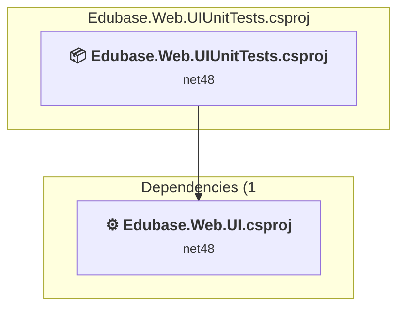

### API Compatibility

| Category | Count | Impact |
| :--- | :---: | :--- |
| 🔴 Binary Incompatible | 1753 | High - Require code changes |
| 🟡 Source Incompatible | 278 | Medium - Needs re-compilation and potential conflicting API error fixing |
| 🔵 Behavioral change | 1 | Low - Behavioral changes that may require testing at runtime |
| ✅ Compatible | 30515 |  |
| ***Total APIs Analyzed*** | ***32547*** |  |

#### Project Technologies and Features

| Technology | Issues | Percentage | Migration Path |
| :--- | :---: | :---: | :--- |
| Legacy Configuration System | 15 | 0.7% | Legacy XML-based configuration system (app.config/web.config) that has been replaced by a more flexible configuration model in .NET Core. The old system was rigid and XML-based. Migrate to Microsoft.Extensions.Configuration with JSON/environment variables; use System.Configuration.ConfigurationManager NuGet package as interim bridge if needed. |
| ASP.NET Framework (System.Web) | 2015 | 99.2% | Legacy ASP.NET Framework APIs for web applications (System.Web.*) that don't exist in ASP.NET Core due to architectural differences. ASP.NET Core represents a complete redesign of the web framework. Migrate to ASP.NET Core equivalents or consider System.Web.Adapters package for compatibility. |

