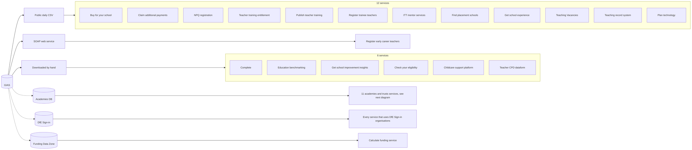
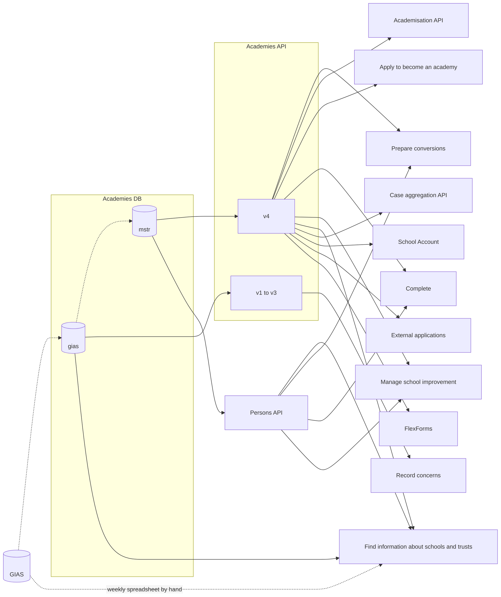

# Where GIAS data goes

A  map of every discovered live system we found that uses GIAS data, and how the data reaches it. Some systems may be undiscovered at time of writing.

## Key

- **Solid line.** We can see the code that moves the data.
- **Dashed line.** The data moves, but the loader is private, so we can't see how.
- **Cylinder.** A database that holds a copy of GIAS data.

## The whole picture

## Through the Academies DB

Notes:

- **`gias` and `mstr`** are schemas in the Academies DB. `gias` is a straight copy of the GIAS tables. `mstr` holds master tables built from it.
- **Most services here never touch GIAS.** They see it through the Academies API, which reads the `mstr` master tables. Private pipelines build those tables.
- **Persons API** serves governance from `mstr`. It also serves MPs, which don't come from GIAS.
- **Complete** appears on both diagrams. It gets open academies from the Academies API, and academies that haven't opened yet by hand from GIAS.
- **Manage free school projects** isn't shown. It reads trusts from its own `dbo.Trust` table in the Academies DB, and we couldn't see where that data comes from.

## Counts

| Route | Live systems |
| --- | --- |
| Public daily CSV | 12 |
| SOAP web service | 1 |
| Downloaded by hand | 6 |
| Academies DB, through FIAT, the Academies API or the Persons API | 11 |
| DfE Sign-in | Every service that uses its organisations |
| Funding Data Zone | 1 |

Complete is counted twice, once by hand and once through the Academies DB.

## Left off the map

- **Archived or dormant.** Early careers framework, Get an identity, Find a tuition partner, Get help with tech, SPI GIAS adapter and SPI tools, Prepare transfers, Identifiers API, `gias-data`, `tslr`, `twd-workforce-data-api` and `support-for-early-career-teachers-legacy`.
- **Tools.** `gias-query-tool`, which loads the public CSV into a local database for ad hoc queries.
- **Further copies.** Several services stream their GIAS tables on into BigQuery, and reports read the Academies DB through private views. We can't see who uses those copies.

## Repositories

The live systems on the map, in the order they appear. Some services have more than one repository. These are the ones that handle GIAS data.

| Service | Repository |
| --- | --- |
| Buy for your school | [buy-for-your-school](https://github.com/DFE-Digital/buy-for-your-school) |
| Claim additional payments | [claim-additional-payments-for-teaching](https://github.com/DFE-Digital/claim-additional-payments-for-teaching) |
| NPQ registration | [npq-registration](https://github.com/DFE-Digital/npq-registration) |
| Teacher training entitlement | [teacher-training-entitlement](https://github.com/DFE-Digital/teacher-training-entitlement) |
| Publish teacher training | [publish-teacher-training](https://github.com/DFE-Digital/publish-teacher-training) |
| Register trainee teachers | [register-trainee-teachers](https://github.com/DFE-Digital/register-trainee-teachers) |
| ITT mentor services | [itt-mentor-services](https://github.com/DFE-Digital/itt-mentor-services) |
| Find placement schools | [find-placement-schools](https://github.com/DFE-Digital/find-placement-schools) |
| Get school experience | [schools-experience](https://github.com/DFE-Digital/schools-experience) |
| Teaching Vacancies | [teaching-vacancies](https://github.com/DFE-Digital/teaching-vacancies) |
| Teaching record system | [teaching-record-system](https://github.com/DFE-Digital/teaching-record-system) |
| Plan technology | [sts-plan-technology-for-your-school](https://github.com/DFE-Digital/sts-plan-technology-for-your-school) |
| Register early career teachers | [register-early-career-teachers-public](https://github.com/DFE-Digital/register-early-career-teachers-public) |
| Complete, Ruby | [dfe-complete-conversions-transfers-and-changes](https://github.com/DFE-Digital/dfe-complete-conversions-transfers-and-changes) |
| Complete, .NET | [complete-conversions-transfers-changes](https://github.com/DFE-Digital/complete-conversions-transfers-changes) |
| Education benchmarking | [education-benchmarking-and-insights](https://github.com/DFE-Digital/education-benchmarking-and-insights) |
| Get school improvement insights, sector | [sap-sector](https://github.com/DFE-Digital/sap-sector) |
| Get school improvement insights, public | [sap-public](https://github.com/DFE-Digital/sap-public) |
| Check your eligibility | [eligibility-checking-engine](https://github.com/DFE-Digital/eligibility-checking-engine) |
| Childcare support platform | [childcare-support-platform](https://github.com/DFE-Digital/childcare-support-platform) |
| Teacher CPD dataform | [teacher-cpd-dataform](https://github.com/DFE-Digital/teacher-cpd-dataform) |
| Find information about schools and trusts | [find-information-about-schools-and-trusts](https://github.com/DFE-Digital/find-information-about-schools-and-trusts) |
| Academies API | [academies-api](https://github.com/DFE-Digital/academies-api) |
| Persons API | [persons-api](https://github.com/DFE-Digital/persons-api) |
| Record concerns | [record-concerns-support-trusts](https://github.com/DFE-Digital/record-concerns-support-trusts) |
| Prepare conversions | [prepare-academy-conversions](https://github.com/DFE-Digital/prepare-academy-conversions) |
| Academisation API | [academies-academisation-api](https://github.com/DFE-Digital/academies-academisation-api) |
| Apply to become an academy | [Dfe.Academies.External](https://github.com/DFE-Digital/Dfe.Academies.External) |
| Manage school improvement | [manage-school-improvement](https://github.com/DFE-Digital/manage-school-improvement) |
| Case aggregation API | [case-aggregation-api](https://github.com/DFE-Digital/case-aggregation-api) |
| School Account | [SchoolAccount-Web](https://github.com/DFE-Digital/SchoolAccount-Web) |
| External applications | [external-applications-web](https://github.com/DFE-Digital/external-applications-web) |
| FlexForms | [flexforms-web](https://github.com/DFE-Digital/flexforms-web) |
| DfE Sign-in | [login.dfe.organisations](https://github.com/DFE-Digital/login.dfe.organisations) |
| Calculate funding service | [funding-service-cfs-backend](https://github.com/DFE-Digital/funding-service-cfs-backend) |
